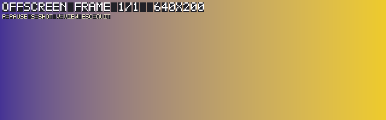
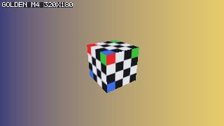

# soft-raster

纯 CPU 软件光栅化渲染器。C++20，零第三方渲染依赖，运行在 Windows 实时窗口里。

这是一个**学习项目**：目标不是做一个引擎，而是把实时渲染管线的每一步亲手实现一遍并且真正理解——
顶点变换、齐次裁剪、透视投影、视口映射、三角形 Setup、覆盖判定、属性插值、深度测试、纹理采样、
光照着色，以及"为什么 CPU 要按 tile 渲染才能并行"。

- 设计文档：[`docs/superpowers/specs/2026-11-21-soft-raster-design.md`](docs/superpowers/specs/2026-11-21-soft-raster-design.md)
- 实施计划：[`docs/superpowers/plans/2026-11-21-soft-raster-m0-m3.md`](docs/superpowers/plans/2026-11-21-soft-raster-m0-m3.md)
- 学习笔记：[`docs/notes/`](docs/notes/)（每个里程碑一篇"为什么"）

## 构建

```bash
cmake -S . -B build
cmake --build build --config Debug
ctest --test-dir build -C Debug --output-on-failure
```

主构建路径是 CMake + Visual Studio 2022（`cl` 不在普通 shell 的 PATH，VS 生成器会自己找到它）。
核心库与测试也能用 MSYS2 g++ 配置编译，但这台机器上 `make` 与 `g++` 不在同一个环境，
需要把三处都指明：

```bash
cmake -S . -B build-gcc -G "MSYS Makefiles" \
  -DCMAKE_MAKE_PROGRAM=/c/msys64/usr/bin/make.exe \
  -DCMAKE_CXX_COMPILER=/c/msys64/ucrt64/bin/g++.exe \
  -DSR_BUILD_APP=OFF -DCMAKE_BUILD_TYPE=Debug
cmake --build build-gcc && ctest --test-dir build-gcc --timeout 60
```

`ctest` 一律带 `--timeout`：Windows 上"缺 DLL"的表现不是报错而是进程起不来，
CTest 会把它记成 Timeout —— 没有上限时，一个误导性故障能吃掉整个会话。

## 运行

```bash
./build/Debug/soft-raster.exe                       # 1280x720 窗口
./build/Debug/soft-raster.exe --width 640 --height 360
./build/Debug/soft-raster.exe --offscreen --frames 1 --width 640 --height 360 --out shot.bmp   # 离屏渲染并存图
./build/Debug/soft-raster.exe --bench 60      # 离屏跑 60 帧并打印每帧耗时
./build/Debug/soft-raster.exe --obj assets/obj/cube.obj   # 载入 OBJ（含 MTL/贴图），自动 fit 相机
./build/Debug/soft-raster.exe --obj assets/obj/cube.obj --golden-write-obj shot.bmp   # 按 M4 固定姿态写 OBJ 图（人眼查看）
./build/Debug/soft-raster.exe --emit-checker-tga assets/tga/checker.tga   # 生成锚 2 的 checker 资产（不渲染）
./build/Debug/soft-raster.exe --help          # 完整选项表
```

可用的按键：`P` 暂停、`O` 单步、`S` 截图到 `screenshots/`、`V` 循环调试视图（color → depth → gray）、
`W` 切换背面剔除、`1` 开关 mipmap（关掉之后斜面与远处开始闪，这是 M4 的验收）、
`2` 循环采样模式 nearest → bilinear → trilinear、`F` 重新 fit 相机（只动 distance/near/far/target，不重置视角）、
`R` 重载当前 OBJ（失败时保留上一份模型，错误行持续到下次成功）、`Esc` 退出。
鼠标左键拖拽 = 轨道旋转，滚轮 = 推拉；把 `.obj` 文件**拖进窗口**即换模型并载入
（非 `.obj` 后缀走 HUD 错误行，不静默忽略）。HUD 第一行显示当前的 `MIP ON/OFF` 与过滤模式，
第二行有 `DC n`（draw call 数）与 `UNRECOGNIZED n`（被忽略的未知指令数），
所以"该看到什么" always 在画面上。

M0 的样子（离屏渲染；HUD 两行文字由自绘的 8×8 位图字体画出，不经过 GDI 字体）：



完整笔记见 [`docs/notes/M0-骨架与像素通路.md`](docs/notes/M0-骨架与像素通路.md)。

M4 的样子（golden 参考图原尺寸 320×180；立方体贴一张程序生成的 checker，
三个角格是 uv 方向标记：红 = `uv(0,0)`、绿 = `uv(1,0)`、蓝 = `uv(0,1)`，第四角留素棋盘）：



完整笔记见 [`docs/notes/M4-纹理与采样.md`](docs/notes/M4-纹理与采样.md) ——
包括"为什么纯棋盘不能当采样测试的夹具"这一族坑（M4 里踩了五次）。

M5 的样子（`--golden-write-obj` 写出，与 M4 参考图零容差相同、只差 HUD 一个字；
立方体的贴图来自 OBJ 引用的 `checker.tga`，经我们自己的 TGA 解析器载入）：


完整笔记见 [`docs/notes/M5-OBJ导入与三次翻转.md`](docs/notes/M5-OBJ导入与三次翻转.md) ——
包括"两个错误互相抵消"为什么是本项目最贵的假通过，以及三条独立的锚怎么各自钉住一次翻转。

## 回归基准

```bash
ctest --test-dir build -C Debug --timeout 60        # 单元测试 + golden 比对
./build/Debug/soft-raster.exe --golden-write assets/golden/m3_cube.bmp   # 重新生成 M3 基准图
./build/Debug/soft-raster.exe --golden-write-textured assets/golden/m4_textured_cube.bmp   # M4
```

写图入口是**三个独立 flag**（`--golden-write` / `--golden-write-textured` / `--golden-write-obj`）
加一个资产生成入口（`--emit-checker-tga`），而不是一个带默认值的场景选择：默认值意味着"忘了指定场景"
会把 M4 的图画进 M3 的路径，而那个错误的症状是"重新生成之后一切正常"。

M5 的 OBJ 场景**不新增参考图**：锚 3 在测试里进程内渲染 OBJ 场景，与既有的 `m4_textured_cube.bmp`
**零容差**逐像素比对（只跳过 HUD 条带）；`--golden-write-obj` 只写给人看的图（notes 插图），不进 `assets/golden/`。
三处方向约定（OBJ 的 `vt`、TGA 的 origin bit、PNG/JPG 的行序）各有独立的锚：
锚 1 钉 `cube.obj` 解析出的三角形与 `makeCube` 一致，锚 2 钉 `checker.tga` 读回字节与 `makeCheckerImage` 一致，
锚 3 钉合成画面。**只有合成检查是不够的**——两处翻转同时做错会抵消，画面看起来完全正确
（实测在 ±1 容差下完全不可见，详见 M5 笔记 §1）。

golden 只在 MSVC 主路径判定（g++ 侧只要求编译 + 纯逻辑单测全绿），理由见
[`docs/notes/M3-深度与插值.md`](docs/notes/M3-深度与插值.md) 第 6 节与
[`assets/golden/README.md`](assets/golden/README.md)。

## 里程碑进度

| # | 内容 | 状态 |
|---|---|---|
| M0 | 仓库骨架、CMake、Win32 窗口 + DIB、测试图案、BMP 截图、位图字体 HUD | ✅ [笔记](docs/notes/M0-骨架与像素通路.md) |
| M1 | 数学库 + 标量 edge-function 光栅器（Backend A）| ✅ [笔记](docs/notes/M1-数学与光栅器.md) |
| M2 | 完整几何阶段：VS / 六面裁剪 / 透视除法 / 视口 / Setup / 背面剔除 | ✅ [笔记](docs/notes/M2-几何阶段.md) |
| M3 | Z-buffer + 透视正确插值 + 顶点色 + golden image | ✅ [笔记](docs/notes/M3-深度与插值.md) |
| M4 | 透视正确 UV + 纹理采样（nearest/bilinear/trilinear）+ mipmap + stb_image/TGA 加载 | ✅ [笔记](docs/notes/M4-纹理与采样.md) |
| M5 | OBJ/MTL 导入 + 多材质 + 包围球自动 fit | ✅ [笔记](docs/notes/M5-OBJ导入与三次翻转.md) |
| M6 | 光照：Gouraud 与 Blinn-Phong 逐像素对比、线性空间 + sRGB | ☐ |
| M7 | 轨道相机 + 阶段可视化 + 计时 HUD（**可演示终态**）| ☐ |
| M8 | tile 分箱 + 多线程（Backend B），验收 ≥15 fps @1280×720 | ☐ |
| M9 | SIMD inner loop（覆盖 + 插值 + 深度掩码）| ☐ |
| M10 | SSAA、golden 脚本化、笔记成文、效果图 | ☐ |

## 依赖策略

渲染数学、光栅化、着色、OBJ 解析全部手写。唯一的第三方文件是 `third_party/stb_image.h`
（只在 loader 里做 PNG/JPG 贴图解码，核心库不感知它），这样网上随便下载的 OBJ + PNG 贴图能直接拖进来演示。
窗口与显示是 Win32 GDI + `CreateDIBSection`：像素由渲染器直接写进 DIB 内存，`BitBlt` 上屏。
HUD 文字也是自绘的 8×8 位图字体——屏幕上没有任何一个像素不是我们算出来的。
