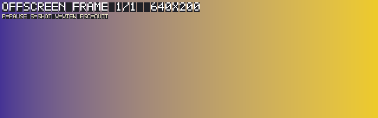

# M0 — 仓库骨架与"像素通路"

里程碑产出：一个能跑的 Win32 窗口 + 一条从"我们算出的像素"到屏幕的完整通路，
外加 58 个单元测试用例、零警告的两条工具链构建。**还没有任何 3D。**



这一篇讲"为什么是这样"，不讲"是什么"（代码就在 `src/`）。

---

## 1. 整块地基是 `ColorTarget::pitch`

`ColorTarget` 是"一块颜色像素的非拥有视图"：`uint32_t* + width + height + pitch`。
所有能画到屏幕上的东西、所有测试图案、以后所有光栅化输出，都只通过它写像素。

为什么要把 `pitch`（行跨度，字节）做成显式字段而不是 `width * 4`：

- GDI 的 DIB、BMP 文件、任何"按行排列的位图"都有行对齐要求。BMP 每行补到 4 的倍数，
  DIB 按 32bpp 恰好是 `width*4`，但**这不保证永远成立**（将来加 16bpp 或带 stride 的离屏目标就会不成立）。
- 测试夹具**故意**用 `pitch = width*4 + 16`（见 `test_render_target.cpp`）。
  如果用连续内存，"行内偏移算对、行跨度算错"这类 bug 在 `y=0` 那一行永远测不出来，
  要到 M3 的立方体底部才第一次露脸——而那时候你会以为是投影算错了。

配套的两个约定也是同一类"现在定下来、以后省一整天的调试"：

| 约定 | 值 | 为什么 |
|---|---|---|
| 行序 | **top-down**，第 0 行是上边缘（C8） | 与 BMP/PNG/绝大多数图像库一致；窗口那边用负 `biHeight` 拿到同样方向的 DIB，于是**窗口路径一次都不用翻** |
| 越界读颜色 | 返回 `0` | 有定义即可，调试视图不该读到垃圾 |
| 越界读深度 | 返回 `+Infinity` | 让 tile 边界外的深度测试**必然失败**。返回 0 的话它会"总是通过"，那种 bug 表现为偶发一个像素错，几乎无法定位 |

## 2. 翻转点必须只有一个，而且要写下来

方向这件事在 M0 出现了三次，每一次都合理，叠起来就是"上下颠倒"：

```
core 渲染        top-down           ——
DIB 显示         负 biHeight ⇒ top-down   不翻 ✓
BMP 文件         格式自底向上        翻一次（在 bmp_writer 里）
```

于是"窗口显示"与"golden BMP"永远一致，因为它们的**唯一差异**是 bmp_writer 那一次转换，
而那一次由测试 `bmp_first_data_row_is_the_bottom_edge` 钉住。

反面做法（`biHeight` 取正值 + 写 DIB 时手动翻行）会多出一个翻转点。两个翻转点的组合
和零个翻转点的组合一样"看起来正常"，但一旦其中一个错了，症状与另一个完全相同，
你无法从画面上区分是渲染翻了还是显示翻了。

## 3. `CreateDIBSection` 的两个小坑

1. **`BITMAPINFO` 带一个 1024 项的 `RGBQUAD`**，直接声明它会在栈上放 16KB 并且 MSVC 会警告。
   32bpp `BI_RGB` 根本没有调色板，所以用一个 `struct { BITMAPINFOHEADER header; RGBQUAD spare[3]; }`
   再 `reinterpret_cast<BITMAPINFO*>` 传进去。
2. **`IDC_ARROW` 已经是 `MAKEINTRESOURCE(...)` 的结果**（伪装成 `LPSTR` 的序号）。
   再套一层 `MAKEINTRESOURCEW` 会触发 C4302；正确写法是 `reinterpret_cast<LPCWSTR>(IDC_ARROW)`。

## 4. sRGB：为什么在线性空间算，为什么 LUT 是 12bit 输入域

光照是线性运算（点积、相加、乘系数）。在 sRGB 值上做这些运算，症状是**整体发灰**；
如果解码和编码各多做一次，症状是**暗部死黑**。这两条症状正好是 Review Focus 5 说的两种情况，
所以 `test_color.cpp` 里既有端点断言、单调性断言，也有往返断言。

LUT 的输入域选择是个真实的权衡：

- 输出本来就是 8bit，所以最"显然"的做法是建一张 256 项表，索引 = `round(v * 255)`。
- 但那等于**做了两次量化**（先把输入量化到 8bit，再查表输出 8bit）。暗部会出现 2~3 LSB 偏差，
  平滑渐变上就是可见的带状条纹。
- 索引量化到 12bit（4096 项）之后，误差被压到 1 LSB 以内，表只有 4KB。

因此对解析式的断言必须是"**与 IEC 曲线相差 ≤ 1 LSB**"，而不是"逐索引相等"：
生产实现用 `float pow`、测试参照用 `double pow`，落在 `.5` 边界的值必然差一格。
（第一版测试写了"逐索引相等"，实测 6/256 个点差 1 LSB —— 那 6 个点不是 bug，是断言写错了。）

gamma 的**语义**由三条测试守住：端点（0→0、1→255）、单调性、往返一致性。

## 5. BMP：为什么"先校验、再拼帧、最后才开文件"

顺序是接口的一部分。反过来做（先 `ofstream` 打开、再发现参数不对）会让一次失败的截图
把**已存在的同名文件截断成 0 字节**。等到 golden 比对失败时，看起来像"渲染回归"，
实际是上一次截图把自己删了。`test_bmp.cpp` 里两条拒绝路径的测试就是为了守住这个顺序。

`pitch != width*4` 的目标也直接拒绝而不是内部重排：截图来源是 DIB，它的 pitch 恰好等于 `width*4`；
支持任意 stride 要引入一次整帧拷贝，那是 M10 的事，现在拒绝比默默做慢要好。

## 6. HUD 文字是自绘的 8×8 位图字体

不用 `TextOut`。两条理由：

1. 设计文档 §10.3 的决定——屏幕上不该出现一个不是渲染器算出来的像素。
2. 实用性——文字必须能在**没有窗口**的离屏渲染里出现（golden 与 `--bench` 都走离屏），
   而 GDI 字体需要 DC。

字形表用**字符画**（`'#'` 是前景）而不是十六进制位表。理由很实际：位表写错一个 bit 没人看得出来，
字符画写错一个 `#` 一眼看得出来。字体最终由"渲染成 BMP 再肉眼读一遍"确认（本页顶部那张图）。

## 7. 这一篇里三个真 bug（都值得记下来）

**(a) `CreateWindowExW` 失败，错误码 1400 = `ERROR_INVALID_WINDOW_HANDLE`**

`WM_NCCREATE` 时成员 `m_hwnd` 还没被赋值（它要等 `CreateWindowExW` **返回**才写），
而我的 `handle()` 在 `default:` 分支里把 `m_hwnd` 传给了 `DefWindowProcW`。
`NCCREATE` 返回失败 ⇒ 整个窗口创建失败。

排查时我先怀疑"这个会话不允许建窗口"（因为症状太像环境问题了），
于是用 PowerShell 建了一个 WinForms Form，`Visible=True` ⇒ 环境没问题，回到自己代码。
**教训**：WndProc 里全程使用消息自带的 `hwnd` 参数，不要用成员句柄。

**(b) 测试进程挂住不退出，CTest 报 Timeout**

`Fixture` 里的 `RenderTarget` 存着指向自己成员 `vector` 的裸指针，而 `makeFixture()` **按值返回**它。
返回那一刻指针悬垂，MSVC Debug CRT 弹出一个没人能点的模态对话框 ⇒ 进程永久阻塞。
症状是"死循环"，实际是内存错误。**教训**：含非拥有视图的结构体必须就地构造，绝不按值返回。
（`Surface` 因此被声明为不可拷贝不可移动，工厂函数返回 `unique_ptr`。）

**(c) g++ 侧 CTest 报 Timeout，但测试其实没跑**

动态链接的测试 exe 依赖 `libstdc++-6.dll`，而 CTest 用 Windows PATH 起进程时找不到它。
**Windows 上"缺 DLL"的表现不是报错，是进程起不来，CTest 把它记成 Timeout。**
解决：GNU 侧 `-static` 链运行时。同时把 `ctest --timeout 60` 定为常规——
挂住的测试必须变成失败，否则它会吃掉整个会话。

## 8. 本机环境事实（换机器时先看这里）

- `cl` 不在普通 shell 的 PATH。MSVC 侧走 CMake 的 VS 生成器（默认就是它），
  或先 call `C:\Program Files\Microsoft Visual Studio\2022\Community\VC\Auxiliary\Build\vcvars64.bat`。
- PATH 上的 `g++` 是 **`/c/msys64/ucrt64/bin/g++.exe`**，而 `make` 只在 `/c/msys64/usr/bin/make.exe`。
  可用的 g++ 侧配置命令（已验证到"零警告 + 全绿"）：

  ```bash
  cmake -S . -B build-gcc -G "MSYS Makefiles" \
    -DCMAKE_MAKE_PROGRAM=/c/msys64/usr/bin/make.exe \
    -DCMAKE_CXX_COMPILER=/c/msys64/ucrt64/bin/g++.exe \
    -DSR_BUILD_APP=OFF -DCMAKE_BUILD_TYPE=Debug
  cmake --build build-gcc && ctest --test-dir build-gcc --timeout 60
  ```

- **C4 的自检命令**：`grep -rn "#include <windows" src/ | grep -v '^src/app'`，期望无输出。
  不要写成 `grep windows.h`——那会命中注释里的字样，一个总是报噪声的检查最终会被跳过。

## 9. M0 没做到的验证

**窗口里真的画出来了吗？** 只有间接证据：`BitBlt` 返回成功（失败时代码会打印并退出非零）、
进程跑完 N 帧退出码 0、帧时间计时正常。我试过从会话外抓窗口内容（`FindWindowW` + `PrintWindow`），
拿不到窗口句柄，估计是窗口站/桌面隔离。

**需要你自己跑一次确认**：

```bash
./build/Debug/soft-raster.exe --width 960 --height 540
```

应该看到：一条平滑移动的紫蓝→橙黄渐变，左上角 `FPS …` 两行文字，`S` 键存截图，
`P` 键暂停（画面冻住不闪），`Esc` 退出。像素内容本身的正确性由离屏路径 + 独立解码器覆盖
（两者共用同一个 `ColorTarget` 写入路径，所以窗口与离屏的差异只在最后那一次 `BitBlt`）。

## 10. 下一步

M1 才第一次出现"三角形"。M0 的全部意义在于：**当 M3 的立方体颜色不对时，
可以立刻排除"像素通路"这一整类原因**——因为那条通路已经有 58 个测试和一张肉眼确认过的图。
