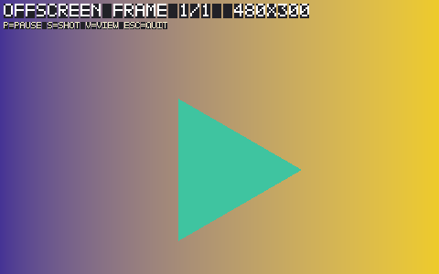

# M1 — 数学库与第一个三角形

里程碑产出：屏幕上有一个纯色三角形，顶点随时间绕中心旋转并"呼吸"。
第一次出现"覆盖判定"这件事本身。



---

## 1. 边函数：整个光栅化只有两个符号需要想清楚

有向边 `e = p1 - p0`，取 `n = {-e.y, e.x}`，则 `evaluate(p) = n·p + c` 在三角形内部为正
（前提：顶点顺序使面积叉积为正）。教科书在 y 朝上的坐标系里写 `n = {e.y, -e.x}`，
符号正好相反——**写反的症状是"整个三角形一个像素都不画"或"画满整屏"**，
这两种症状都很显眼，所以这个错反而不难查；难查的是下面那个。

### 内侧法线只对一种绕向成立

`{-e.y, e.x}` 让"叉积为正"的顶点顺序内部为正；叉积为负的顺序就必须取反。
而 M2 会证明：**top-down 屏幕空间里正面三角形恰好是叉积为负的那一种**。
于是 M1 的全部测试用例（都是正绕向）永远测不到这个分支，
bug 一直活到立方体接进来，症状是 `fragmentsCovered = 0` —— 一个像素都不画，
但剔除计数、裁剪计数全都正常，看起来像"相机没对上"。

修复是给 `EdgeFunc::fromEdge(a, b, sign)` 加一个由面积符号决定的 `sign`，
**而不是把顶点顺序改写**：改顺序会让"取第一个顶点的 varying"这种 flat 取值悄悄换掉一个顶点。
补上的测试 `reversed_winding_covers_exactly_the_same_pixels` 断言绕向无关性——
它现在在，所以这个 bug 不会再活第二次。

**教训**：一个"只有一种输入会走到"的实现，测试必须覆盖另一种输入，哪怕当下没有那种输入。

## 2. top-left 填充规则：权威是测试，不是我的推导

规则本身：像素中心恰好落在边上时，只有**顶边**和**左边**把它算进来。
两条判据都写成"第三顶点相对这条边的位置"，而不是 `e.x/e.y` 的符号比较——
因为 y 轴方向一变，符号判据就得重推一遍，而"第三顶点在哪一侧"这件事与坐标系无关。

但这条规则的正确性**不由这段文字判定**，由这条测试判定：

```
4×4 像素的正方形，沿对角线劈成两个三角形
⇒ 16 个像素中心必须全部被写，且每个恰好被写一次
```

判据用"两个三角形覆盖数之和 == 16"，于是：缝隙 ⇒ 总和 < 16，双写 ⇒ 总和 > 16。
**不需要手算 mask 就能把 fill rule 唯一化**，而且两个劈分方向都测
（只有一方向失败 ⇒ top/left 的符号错了；两方向都失败 ⇒ 别的地方错了）。

这件事在 M8/M9 会变成硬约束：Backend A 用 `< 0` 判边、Backend B 的 SIMD 掩码用 `>= 0` 的话，
相邻三角形之间会出现网格状暗线，而那种 bug 在优化之后才出现，你会以为是优化写坏了。

## 3. 平面方程：三值定面，克莱姆法则

给定三个 (x, y, value)，解 `f(x,y) = n0·x + n1·y + c`。
系数矩阵的行列式就是两倍的有向面积，所以**共线 ⇒ 无解**，这一点在 M3 会变成
"退化三角形在 Setup 就被拒掉"的依据。`PlaneEq::degenerate` 标志必须显式存在：
让 `n0/n1` 变成 inf 的话，症状要到插值之后才出现，而那时候已经看不出是几何的问题。

## 4. 零向量的约定是接口，不是防御式编程

`normalize({0,0,0})` 返回 `{0,0,0}` 而不是 NaN。真实 OBJ 里重合顶点、零面积面一定会出现，
而 NaN 进光照会污染一整块区域，症状是"某片区域偶发变黑"——
那种 bug 的定位成本远高于这一行 `if`。同理 `cross(Vec2, Vec2)` 返回标量：
它的符号就是"点在边的哪一侧"，是边函数的全部基础。

## 5. 测试夹具的两个坑（都在 M1 前后踩到）

1. **含非拥有视图的结构体不能按值返回**。`RenderTarget` 里存的是指向自己 `vector` 成员的裸指针，
   返回一次就悬垂一次；MSVC Debug CRT 会弹一个没人能点的模态框，症状是**测试进程挂住**，
   CTest 报 Timeout，看起来像死循环。（`Surface` 因此被声明为不可拷贝不可移动。）
2. **`memcmp` 比指针数组是假通过**。`memcmp(glyphFor('0').rows, glyphFor('O').rows, ...)`
   比的是 8 个地址，任何两个不同表项都"必然不同"。要逐行 `strcmp`。

## 6. 一条被推翻的测试期望值

`covered_count ≈ 面积 32` 是错的。像素中心计数本来就不等于面积（误差量级是周长的一半），
而且 top-left 规则会把**顶边与左边**两串边界像素算进来。精确值是 36：

```
Pick 定理  A = I + B/2 - 1  ⇒  32 = I + 24/2 - 1  ⇒  I = 21 个严格内部点
顶边边界像素 8 个 + 左边边界像素 8 个 - 左上角重复 1 个  =  36
```

斜边上的 8 个边界点一个都不算进来——那正是"相邻三角形不重不漏"的另一半证明。
现在测试断言的是 36 并且把这段推导写在旁边。

## 7. 下一站

M2 把这个三角形换成 Mesh：VS → 六面裁剪 → 透视除法 → 视口 → Setup → 光栅。
`rasterizeFlatTriangle` 会被 `BackendA::draw` 取代，但它的测试全部保留——
因为逐像素循环是两个后端共享的（`forEachCoveredPixel`），fill rule 只有一份实现。
