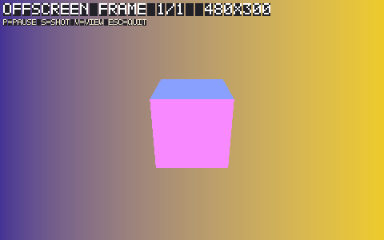

# M2 — 从 Mesh 到屏幕：完整几何阶段

里程碑产出：一个 MVP 变换的旋转立方体，每面一个颜色，背面剔除生效，
六面裁剪生效，`depthTest` 标志位预留（恒通过）。**还没有深度测试**——这是故意的。

---

## 1. 为什么是六面裁剪，而不是"只裁近平面"

只裁近平面是 tinyrenderer 一类教学代码的常见做法，够用但不完整：视锥 x/y 之外的三角形
仍然会被投影成**极大**的屏幕坐标。后果不在 M2 显现，而在 M8/M9：

- tile 分箱要把三角形"覆盖的 tile 范围"写进 bin，坐标炸开 ⇒ bin 范围炸开；
- M9 若用定点 edge function，大坐标直接溢出。

于是只能靠 scissor 硬夹——把问题从源头挪到了下游。六面裁剪把这一整类问题在源头消掉，
代码只多约 40 行（同一个 Sutherland–Hodgman 循环参数化到 **7** 个判据平面，`kClipPlaneCount`），而且这正是 GPU 的做法。

**裁剪输出顶点数的上界是 10，不是 5。**（旧版这一句写 9，漏数 `kPlaneNegW`；`8ed3306` 更正。）初稿按"三角形切三刀 ⇒ 最多 5 个顶点"设计接口，
实测一个同时跨过多个平面的三角形产出 6~8 个。正确推导：两个凸多边形相交，结果顶点数
≤ 两者之和 = 3 + **7** = 10（裁剪面是七个：六个视锥面 + `kPlaneNegW`）。上界写小的后果是**静默截断**，症状是"模型某些角缺一块"，
比崩溃难查得多。现在 `kMaxClippedVerts = 3 + kClipPlaneCount` 写在头文件里。

## 2. 裁剪阶段插值的到底是什么：`clip` 与**未除的** `v` 用同一个 t

代码事实：`ClipVertex.v` 是**未除的**属性（`vertex.h:68-71`），裁剪对 `clip` 与 `v` 用同一个 t（`clipping.cpp:10-18`）——沿 clip 边两者都线性。〔留痕：本节此前写"ClipVertex 存 `vOverW = v/clip.w`"，那正是 `cd7c6b0` C2 反转**之前**的做法，与现状相反。〕
这是透视正确性的落点，推导值得背下来：

1. 沿一条 clip 空间的边，`attr` 与 `w` **各自**线性 ⇒ 用同一个 t 插值两者、再相除，就是那个屏幕点的正确值。
2. 屏幕空间里 `1/w` 与 `attr/w` 仿射、`attr` 不是 ⇒ setup 为 `planeInvW` 与 `planeAttr`（建自 `attr/w`）各解一平面，逐像素相除（`interpolate.h:19-20`、`:43-49`）。
3. 错法是"**先除以 w 再插值**"：`attr/w` 在 clip 空间是线性/线性。A(w=1,u=0)、B(w=2,u=3) 中点正确值 **1.0**、旧实现 **0.75**
   —— 症状是纹理/颜色随视角被"拉回"三角形中心（`cd7c6b0` C2 的实测数）。

`tests/unit/test_interpolate.cpp:68` 的 `perspective_correct_u_at_edge_midpoint` 钉住第 3 条（旧版本所有顶点 w 都等于 1，结构上抓不到这个错——`cd7c6b0` C2 原话）。

## 3. 绕向：这一篇里最贵的一个符号

三次返工，全部源于同一个地方。

**(a) 口算"顺时针"是错的。** 计划里写"top-down 里正面是 CW ⇒ area2 < 0"，
测试第一版按"(0,0)-(10,0)-(0,10) 是顺时针 **⇒ 所以它是正面**"断言，结果与实现相反（错在后半句：它确实视觉顺时针，但它是**背面**）。
真正的四步推导链：

1. Mesh 约定：从物体外面看是逆时针（右手系，世界空间）。
2. `view * proj` 保持手性进入 NDC（y 朝上）：正面三角形的 shoelace 叉积为**正**。
3. Viewport 把 y 翻成 top-down（C8）⇒ 叉积符号**翻转**。
4. 所以：**屏幕空间里 area2 < 0 是正面**。〔2026-11-27 实测更正：原句把 GPU 文档的"clockwise"套在它上面是错的词——y 翻转只翻有向面积的符号，不翻肉眼旋向，正面在屏幕上仍是**逆**时针。〕

**(b) 权威判据不是符号，是语义。** 现在测试里有一条与符号约定无关的判据：
`dot(外法线, eye - 顶点) > 0` 的面才该被画。符号约定可以改，这条不能。
它顺带纠正了一个正交投影的直觉：正对姿态下立方体的 4 个侧面**不是"棱对"而是"背对"**
（dot = -1 而不是 0），所以它们走 Backface 而不是 Degenerate；
"8 个退化三角形"只在正交投影下才成立。

**(c) EdgeFunc 的内侧法线只对一种绕向成立。** `{-e.y, e.x}` 让"面积叉积为正"的顶点顺序内部为正；
而正面恰好是负叉积 ⇒ 所有正面三角形 `covered = 0`。
M1 的全部测试用例都是正绕向，所以这个 bug 到立方体接进来才暴露。
修复是给 `fromEdge` 加一个 `sign` 参数由 area2 的符号吸收；**不改顶点顺序**，
因为改顺序会让 flat 取值的"第一个顶点"悄悄换掉。
新增测试 `reversed_winding_covers_exactly_the_same_pixels` 钉住绕向无关性。

## 4. "没有深度就有穿帮"需要一个前提

凸立方体在**剔除开着**时根本不穿帮：三个可见面的投影只在棱上相接，互不覆盖。
要看到 painter's 算法的缺陷必须关掉剔除——于是 M2 的演示键（`W`）其实是"关掉剔除"。

这件事值得单独记一句：**背面剔除本身就是一种遮挡求解**。它解决凸体的遮挡，
解决不了凹体与互相遮挡的物体，所以需要 M3 的深度缓冲。

缺陷被测试 pin 住了（`no_depth_no_cull_shows_the_painter_artifact`）：
正对姿态 + 关掉剔除时，中心像素是**最后画的 -Z 面**的颜色而不是 +Z 面。
M3 打开深度后，同一场景、同一个像素必须翻转成正面。

## 5. 判定顺序是接口的一部分

Setup 的拒绝顺序：非有限 → 退化 → 朝向 → 离屏。

- 先查非有限：NaN 会让后面所有比较为假，症状是"整屏不画"。
- 退化在朝向之前：面积≈0 时朝向无意义，先判朝向会让归类随 eps 抖动，
  症状是"同一条棱有时画有时不画"。
- 离屏与退化分开计数：前者是正常事件，后者是上游有问题的信号，混成一个计数会掩盖 bug。

## 6. 下一站

M3 把三件事接上：深度测试与写入、`attr/w` 的平面方程插值、以及把 flat 取值换成真插值。
M2 预留的 `depthTest` 标志位在这里填实现——**不重构光栅阶段**，这是 spec 矛盾 7 的裁决兑现。
