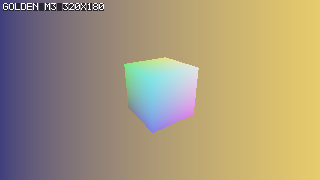

# M3 — Z-buffer、透视正确插值、golden 回归

里程碑产出：遮挡正确的平滑顶点色立方体 + 深度/灰度调试视图 + 第一份 golden 基准图。



---

## 1. 插值只有三行实质内容，但它是整条管线的枢纽

```
invW  = planeInvW(x, y)              // 1/w 在屏幕空间是仿射的
attr  = planeAttr(x, y) / invW       // planeAttr 建的是 attr/w，同样仿射
depth = planeDepth(x, y)             // 深度不需要除
```

**为什么 `attr` 必须除以 `invW`**：屏幕空间里线性变化的是 `attr/w` 与 `1/w`，`attr` 本身不是。
直接用 `planeAttr` 的值当属性，症状是纹理/颜色被拉向三角形中心，且随视角变化。

数值证据（`perspective_correct_u_at_edge_midpoint`）：一条边从 `w=1` 走到 `w=10`、属性从 0 走到 1，
屏幕中点处的透视正确值是 **1/11 ≈ 0.0909**，线性插值会给 **0.5**。测试同时断言
`|u - 0.5| > 0.4`，也就是**证明这条测试有区分力**——只断言"等于 0.0909"的话，
一条写错的测试也可能因为实现同样写错而通过。

**为什么深度可以线性**：`depth = ndcZ*0.5+0.5`，而 `ndcZ` 在屏幕空间里仿射（`z_view` 与 `w` 成正比）。
这条以前只写在注释里，现在有 `depth_is_affine_in_screen_space` 把它变成被验证的断言。

## 2. `invW` 趋零：夹住并计数，而不是静默返回垃圾

`w → ∞` 时除法会把浮点噪声放大成 inf/NaN，顺着颜色污染一整块区域。
实现里保号地夹到 `1e-8` 并递增 `interpClampedCount`，HUD 上看得见。

这条测试差点是假的：第一版采样点取在 `(9.9, 0.1)`，那里 `invW` 还有 0.01，**根本没触发夹住分支**，
计数为 0 才暴露出来。教训：写"边界分支"的测试时，要能说出这个输入为什么一定会走到那条分支。

## 3. 深度测试的三个非显然事实

1. **比较用 `<=`**：共面时后画者赢。这就是 Z-fighting 的取舍，测试把它 pin 住而不是假装不存在
   （`coplanar_triangles_last_writer_wins_because_comparison_is_less_or_equal`）。
2. **`depthTest` 与 `depthWrite` 互相独立**：`write=false` 时既不遮挡也不污染。
   把它们绑在一起是实现里很容易犯的错，所以有专门的测试分开失败。
3. **绘制顺序决定测试有没有意义**：`nearer_triangle_wins` 第一版是"远的先画、近的后画"，
   于是 `fragmentsDepthRejected` 恒为 0 —— 那条断言测的其实是"绘制顺序恰好让深度没机会起作用"。
   改成"近的先画、远的后画"之后，深度拒绝才真的发生。

## 4. 线性空间这件事，在颜色测试里露了一次面

`centroid_color_is_the_mean_of_vertex_colors_in_linear_space` 把像素**解码回线性**再比较。
若在 sRGB 字节上取平均会得到另一个数（0.5 线性 → 188 sRGB，而三个纯色的 sRGB 平均值
不等于平均后的 sRGB 值）。这本身就是"为什么光照必须在线性空间做"的最小演示，
所以它值得单独一条测试，而不是等 M6 才讲。

## 5. 调试视图：归一化不是可选的

深度视图如果直接画 `depth`，几乎所有像素都挤在 1.0 附近（非线性深度的固有性质），
看起来一片白——那种"看起来正常"的视图没有诊断价值。所以视图带 `depthNear/depthFar` 归一化区间，
并且**近 = 亮、远 = 暗**这个方向被测试钉住（方向反了的话，读 bug 的人会得出相反结论）。

两条约束值得单独说：sink 只改颜色、绝不写深度（否则"切个视图"会改变渲染结果，
症状是调试工具本身让画面变了）；app 里 sink 在 HUD 文字**之前**应用，否则切到深度视图时文字被一起冲掉。

## 6. golden：参考图必须由被测的同一个函数生成

初稿把 golden 场景放在 `tests/golden/`，app 里另有一份动画渲染代码——那样"这张参考图是怎么来的"
就成了口头承诺。现在场景在 `src/scene/golden_scene.cpp`，测试与 `--golden-write` 调用同一个函数。

三个设计决定：

| 决定 | 理由 |
|---|---|
| 参考图缺失 = **失败**，不是 SKIP | 静默 SKIP 会让"golden 从没跑过"看起来像"golden 全绿" |
| 路径由 CMake 注入 `SR_SOURCE_DIR` | CTest 的 cwd 是 `build/`，相对路径会让"找不到文件"被误读成"没提交" |
| 只在 MSVC 判定，容差 ±1/255/通道 | g++ 与 MSVC 的标准库数学不保证逐位一致，GCC 默认还会融合 FMA；为 bit-stability 自建数学库与学渲染无关 |

**破坏性验证**（golden 必须能失败）：把 `Viewport` 的 y 翻转去掉 → golden 报出大量差异并失败；恢复 → 全绿。
没做过这一步的 golden 框架等于没有。

## 7. 顺带修掉的一个测试基础设施问题

`test_util.h` 用了 `sr::Vec3` 却没 include `math/vec.h`，靠某个测试文件恰好先包含了它才没报错。
这类"靠包含顺序活着"的测试代码会在下一次改动时炸掉，已补上。

另外本会话里踩了两次同一个坑：通过脚本往 C++ 源码里插入含 `\\n` 的字符串时，转义被吃掉变成真实换行，
编译器报 `C2001 newline in constant`。现在这类插入一律改用 `std::puts`（自带换行，不需要转义）。

## 8. 下一站

M4 把 `uv` 变成真的纹理坐标：`st.dudx/dudy/dvdx/dvdy` 这四个数在 M2 就已经算好并 pin 住了，
等的只是消费它们的人。M5 接 OBJ，M6 接光照，M7 才有"能演示的终态"。
