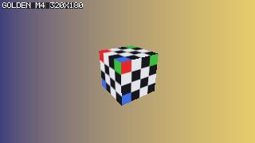

# M4 — 纹理采样、mipmap、以及"夹具的对称性"

里程碑产出：立方体贴一张程序生成的 checker，旋转不扭曲；`1` 键关掉 mip 会闪、打开不闪；
第二份 golden 基准图（`m4_textured_cube.bmp`）与第一份共存。



---

## 1. 这一章真正的主题：夹具在某个对称操作下不变，那个操作就测不出来

M4 的六个任务里，有**四次**踩在同一族坑上，而且每次都是"实现正确、测试永远不可能红"：

| 任务 | 夹具的对称性 | 被放过的错误 |
|---|---|---|
| 4.2 wrap | `-0.25 * 4 = -1.0`，floor 与截断同值 | 负 UV 的取整方式写错 |
| 4.3 双线性 | 等差值 0/64/128/192 在镜像权重下不变 | v 方向权重接反 |
| 4.4 三线性 | `rho = 64` 使 `log2` 正好落在整数 6，`frac = 0` | 夹到末级却保留 frac |
| 4.5 端到端 | 四边形在屏幕上是**方形足迹**（W == H） | `gradU/gradV` 整个转置 |
| 4.7 贴图 | 纯棋盘格在**转置**下恒等 | uv 的 u/v 对调 |

每一条的修法都不是"多写几条断言"，而是**把夹具换成不对称的**：倍增序列 32/64/128/255
（任意凸组合互不相等）、`-0.1 * 4 = -0.4`、`rho = 1.7`、400×100 的宽扁四边形、
三个角各一种标记色 + 第四角留素棋盘。

写插值/索引/采样类测试时的固定一问：**"把两个轴（或两个权重、两种取整）对调，我的夹具会给出不同的数吗？"**
答"不会"就还没资格写断言。这一族的判据也顺带出来了：**变异存活 = 夹具对称**，
所以每个新测试文件都配一轮变异验证（M4 一共做了 15 轮，其中一轮直接抓出 §7 那个真 bug）。

## 2. texel 中心约定与 off-by-half

`u = 0` 落在第 0 个纹素的**左边缘**，不是它的中心。所以

```
索引 = floor(u * W)          纹素 i 的中心在 (i + 0.5) / W
```

D3D 与 OpenGL 的地址约定在这里是一致的。判别方法不是"取中心看看对不对"，而是
**在边界两侧各取一个点**：`u = 0.5/W - ε` 与 `u = 0.5/W + ε` 必须落在**相邻的两个不同**纹素上
（`test_sampler.cpp` 专门 pin 这一条）。只断言中心值的话，"边界落在纹素中心"那种错一半的写法
会在中心点上给出同样的答案。

双线性用的坐标系是 `centered = u * W - 0.5`，`f = centered - floor(centered)` ——
也就是把"纹素中心"当插值的整数格点。nearest 与 bilinear 共用 `texelIndex`/`wrapCoord`
这一层，因为 uv→下标若写两遍，就会有一处悄悄漂半个纹素，而症状不是崩溃，是整张贴图偏移。

## 3. sRGB 解码发生在采样时，不是加载时

`Texture` 带一个 `srgb` 标志，字节永远是 8bit 原样，采样时才查表解码（Ruling 27）。
三个理由，每个都有代价对照：

1. **加载时解码要把 8bit 存成 float**，内存 ×4，而 mip 链还要再乘 4/3。
2. **mip 平均会在编码空间里做** —— 那是错的平均。数值证据：字节 0 与 128 两个纹素，
   正确的线性平均是 `0.5 * (0 + 0.2158) = 0.108`，而在字节上平均再解码得 `(128/255)` 线性
   ≈ `0.251`。肉眼读出来就是"中间调整体发灰"。
3. **数据纹理不该被解码**：uv 调试图、M6 之后的法线贴图。解码会把 0.5 变成 0.73，
   "uv 视图"就不再接是 uv。这正是 GPU 区分 `SRGB8_ALPHA8` 与 `RGBA8` 的理由。

alpha 永远不做 gamma 解码 —— 它是覆盖率，不是颜色（`sampleNearest`/`sampleBilinear` 里
`a = value/255`，与 `srgb` 标志无关）。

解码路径抽成 `toTexelF`，nearest/bilinear 共用：写两遍的话，将来只改一遍就会出现
"同一张图两种过滤给出不同的暗部"。

## 4. 过滤与 mip 是两个正交的旋钮

`SamplerState{wrapU, wrapV, filter, useMip}`。`useMip=false + Trilinear` 是合法组合，
语义是"仍按 frac 混，但永远在 level 0"（实测就是 `Lod{0, 0}`，等价于双线性）；
`Nearest + useMip=true` 则是"在被选中的那一级上取单个纹素"。
按键表把它们分开列（spec §7.6），实现就必须是两个字段而不是一个枚举。

采样状态放 `FragmentUniforms` 而不是 `PipelineState`（Ruling A）：`PipelineState` 剩下的字段
（cull / depthTest / target）全是**固定功能阶段**读的，采样是 FS 的事；混进去会让光栅阶段依赖采样概念。

`wrap` 用 `ClampEdge`（golden 与 app 都是）：立方体每面的 uv 正好铺满 `[0,1]`，
`Repeat` 会让 `u=1` 的边界回绕到第 0 列纹素，于是面的右边缘出现一条"从另一侧抄过来的颜色"。
那不算 bug，但它让参考图看起来像接错了。跨边界回绕的行为由 4.2/4.3 的单测覆盖，不需要靠参考图守。

## 5. LOD：各向异性取 max 而不是平均

`rho = max(|∇u|·W, |∇v|·H)` 逐像素取两个方向里**变化更大**的那个，`level = floor(log2 rho)`。

为什么不是平均：平均会让"一个方向被大幅压缩、另一个方向几乎不变"的情形选到偏低的层级，
于是那个高压缩方向仍在**过采样不足**——症状是一条方向上的锯齿与闪烁，而另一方向看起来正常，
所以很容易被当成"过滤没生效"。取 max 保证两个方向都不欠采样，代价是各向异性拉伸的表面上
贴图会糊得偏保守（真正的解法是各向异性过滤，那是 N 系列之外的东西）。

`Lod{level, frac}` 是 LOD 的唯一表达，取整版 `mipLevelFromDerivatives` 退化成它的一行包装（Ruling 30）：
两份 log2 实现必然漂移，而漂移的症状是"某些镜头角度下 mip 跳一级"，属于最难复现的一类。
不变式 **`frac > 0 ⇒ level + 1 < levelCount`** 是三线性不越界的**全部**依据，有专门一条测试盯着它。

输入单位是**归一化 UV/像素**（`TriangleSetup::dudx/dvdy` 直接给的东西），不是纹素/像素。
上一版测试按纹素/像素传值，四条断言整齐差 `log2(256) = 8` 级 ——
**"差一个固定常数而不是随机错"就是单位错的指纹**。夹取放在函数内部而不是交给调用方"记得夹"：
靠约定 = 安排它哪天忘一次，而越界读 `levels[level]` 的症状是崩溃。

## 6. mip 链在 2x1 处的那一级是边缘复制，不是"真实平均"

`downsampleBox2` 对两个维度都向下取整 ⇒ 2×1 的下一级算成 1×**0**。
0 厚的一级没法采样（`texel()` 必然返回 nullptr），而且它让"级数 = log2(边长)+1"
在所有非 2 的幂尺寸上失效。实测 8×4 的链只有 3 级，而按 4 级去索引 `chain[3]` 的测试
**把整个测试进程带走了**（MSVC Debug 的下标检查 → abort → rc=3，stdout 全缓冲，
连先打出的 FAIL 行也一起没了）。7 个尺寸里 4 个（8x4、5x3、1x8、7x2）的链尾被吃掉。

决定（Ruling 24）：每一维的下限是 1，链以 1×1 收尾。夹取 = 复制边缘纹素，**分母仍然是 4**，
所以"平均保持性"不被破坏（`mip_chain_of_a_gradient_keeps_the_mean_constant` 继续绿）。
这与硬件的完整链定义一致，不是自创。

同族的一条纪律（Ruling 26）：**测试不许越界索引自己的输出**。
先 `SR_ASSERT_EQ(chain.size(), 4)` 再理直气壮地 `chain[3]`，在实现错的时候是消灭证据而不是报告失败。

## 7. 立方体的 uv 一直是错的：蝴蝶结，以及藏在其后的 90°

接贴图当天，端到端测试三条断言红，症状是"uv(0,1) 的蓝标记出现在 uv(1,1) 的位置"。
没有去改测试，而是加了一条临时 PROBE：同一套姿态换一个把 `in.v.uv` 写进颜色的 fragment shader，
于是能读出**实测 uv** —— 期望 `(0.125, 0.875)` 实测 `(0.761, 0.880)`。
不是采样器错，是 `makeCube` 的 uv 错。两个问题叠在一起：

**(a) 蝴蝶结。** `appendQuad` 按顶点下标的位模式赋 uv（`{i&1, i>>1}`）。
四角是绕序的（左下、右下、右上、左上），位模式给出 `(0,0)(1,0)(0,1)(1,1)` ——
右上与左上的 uv 互换，于是这四个点按顺序连起来是一个**自交的多边形**：
鞋带公式的有向面积 = 0（两叶互相抵消），而正确的参数化应该是 1。
每张贴图沿一条反对角线翻折回去。

**(b) 90° 旋转。** 修 (a) 的时候发现：**按下标查的 uv 表根本表达不了"v=0 在顶边"这条约定**。
六个面的角序都是绕序的，但起点不同 —— `+Z/-Z` 从底边左角起步（下、下、上、上），
`+X/-X` 从左边起步（下、上、上、下）。同一张表在 ±X 上会让贴图的 u 轴指向世界的上方。
这个 90° 从 M2 就一直在，只是双色棋盘转 90° 看不出来，而带角标记的贴图看得出来。

最终形态：uv = 角在这一面局部坐标系里的**角色**。侧面 `up = +Y`，顶面 `up = -Z`、底面 `up = +Z`
（没有 +Y 可用，所以必须**选**一个并写下来，选完就有断言盯着）；`right = up × normal`；
`v=0` 给 up 侧两角，`u=1` 给 right 侧两角。于是全栈只剩一条方向规则：

> 图像第 0 行 = 顶部、采样器 `v=0` = 第 0 行、mesh 的 `v=0` = 面的顶边 ⇒ **贴图与图像同向**。

OBJ 的 `vt` 原点在**左下**，那一次 `v = 1 - v` 由 M5 的载入器负责 —— 格式的差异在格式的门口处理掉，
不留进管线。

**为什么到 M4.7 才发现**：M2/M3 没有任何 shader 读过 cube 的 uv。
**没被消费过的属性不会自己报错** —— 这句话的实操含义是：一个字段"存在但没人读"的时候，
它的测试覆盖是零，而它会以"看起来是数据问题"的形式在第一个消费者出现那天爆炸。

守门测试分三层，缺一层就放过一类错误：
① 四个 uv 都是单位正方形的角（**蝴蝶结也满足这条**，第一版只写了它，看到抓不住才补的后两层）；
② 空间对角 ↔ uv 对角（蝴蝶结给的是 1 而不是 √2）；③ uv 多边形有向面积 == 1（蝴蝶结 = 0）。
再加一条端到端的"红色格心的屏幕 y 必须比蓝色小 10 像素以上"，并且三条分类断言一起写，
防止那条排序断言在预测跑飞时碰巧成立。

## 8. 端到端断言用"颜色分类"而不是逐字节相等

golden 场景是三线性 + mip，格心会与邻居混一点，混合比重随姿态连续变化 ——
逐字节断言会抖动，而抖动的测试最后会被"放宽到 32"，那就等于没断言。
分类器要求"最近的颜色比第二名近 2 倍以上"，否则报"分不清"，于是两件事同时成立：

- 混合出来的中间调**不会**被算成某个角；
- "格子边界应当是混合"本身成了可断言的（`cell_boundary_is_a_blend_so_the_filter_is_really_in_the_loop`
  断言的正是"分不清"，并附带要求它落在 dark 与 light 的中点附近）。

**诚实的边界**：4×4 格的贴图**无法**端到端区分 Bilinear 与 Trilinear —— 格心在 level 0/1/2 上
都是纯标记色（一格 32 纹素，level 1 是 16、level 2 是 8，中心都落在同一格里），
而 mip 的差别只出现在高频细节上。所以这条测试的注释里明写它守什么、不守什么；
mip 的守门是 4.1/4.4/4.5 的 11 条 LOD/梯度单测 + 参考图的逐字节比对 + 肉眼验收。
不为了"看起来全面"写一条恒真的断言。

## 9. 第二份 golden：与第一份共存，两个入口而不是一个默认值

`renderGoldenSceneTextured()` 是**新函数**，不是 `renderGoldenScene` 的改动 —— 后者被 main.cpp 与
`m3_cube.bmp` 用着，把纹理塞进去会当场作废 M3 的回归锚点。两者共用姿态常量
（`kGoldenModelRotX/Y`、`kGoldenCamZ`、`kGoldenCubeSize`，数值一字未改），
所以 M3 的逐字节比对顺便证明了"这次重构没有改变任何东西"。

| 决定 | 理由 |
|---|---|
| 写参考图是两个 flag（`--golden-write` / `--golden-write-textured`） | 带默认值的"场景选择"意味着忘了指定就会把 M4 的图画进 M3 的路径，而它的症状是"重新生成之后一切正常" |
| 比对逻辑一份，场景函数以指针传入 | 两份循环会在某次改动里只被改到一处（容差、报告条数、缺图怎么办），而没人会读那个一直绿的测试 |
| 贴图与窗口用**同一个单例** | "窗口里验收过的画面"与"参考图守住的画面"必须是同一张贴；各自建一份的话改一边不会让另一边变红 |

**破坏性验证**（golden 必须能失败）：把 golden 的过滤从 Trilinear 改成 Nearest →
参考图报 1143 个差异像素并失败，而 M3 那张仍然绿（分工正确）；把参考图临时改名 →
报"缺少参考图"并给出正确的生成命令，而不是静默 SKIP。另外验证过重新生成逐字节一致。

## 10. 顺带说清的两件基础设施事

- **构建失败时绝不读测试结果**。本里程碑里又踩了一次（sed 把 `, count, wrap);` 一起注释掉，
  `grep -c` 已经报了 3，我看见数字是 3 却继续跑了）。现在变异循环固定这个形状：
  `out=$(cmake --build ... | grep -E "warning|error"); if [ -n "$out" ]; then 结论作废; else 跑测试; fi`
- **Release 验证一律 `--clean-first`**，而且 `grep` 到告警必须看清是什么，不能只数数。
  `plane_eq.h` 那条 C4723 是 Release 全量重建才定位到的（增量构建会把它藏起来），
  最后用"头文件范围的 disable"压掉而不是改守卫 —— 那个 `!(fabs(det) > eps)` 的写法顺带挡住 NaN，
  改成 `fabs(det) < eps` 就会放 NaN 过去做除法（Ruling 35，另有一条测试钉住 NaN 语义）。

## 11. 下一站

M5 把 OBJ/MTL 接进来：`vt` 的原点翻折、多 material 的 draw call、包围球自动 fit，
以及第一次用 `stb_image` 读网上下载的 PNG 贴图 —— 于是 §3 那套 sRGB 约定会立刻接受考验：
外部图片全是 sRGB 编码的颜色数据，而 uv 调试图不是，两者的差别第一次变成可见的。
