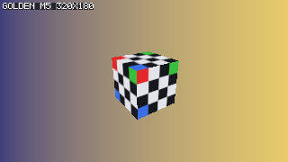

# M5 — OBJ 导入、三次翻转、以及"两个错误互相抵消"

里程碑产出：`--obj <path>` 把任意外部 OBJ（含 MTL 与 PNG/JPG/TGA 贴图）载入窗口并立刻可见，
不管单位是 mm 还是 m；多 material → 多 draw call（`FrameStats::drawCalls` 可断言）；
包围球自动 fit 相机；中文路径能载入。三处方向约定各有独立的锚，396 个用例三侧全绿。



（这张 PNG 是**文档插图**，不是回归资产：它由 `--golden-write-obj` 写出给人看，
锚 3 的比对在测试里进程内做、对着既有的 `m4_textured_cube.bmp`，不新增参考图。见 §5 与收紧 2。）

---

## 1. 这一章真正的主题：抵消

M5 有**三处独立的方向约定**要从文件格式翻译进管线（设计 §1）：

| 约定 | 文件里怎么说的 | 我们怎么表示 | 翻译发生在 |
|---|---|---|---|
| `vt` 的 v 轴 | v=0 是**图片下边缘**（OBJ 惯例） | v 正方向往下（`texture.h`） | obj 解析器出口（`obj.cpp:59`） |
| TGA 的行序 | header bit5 决定 origin 在上还是下 | 一律 top-down（C8） | tga 解析器（`image_tga.cpp:121`） |
| PNG/JPG 的行序 | 总是 top-down | top-down | `image_stb.cpp:82`（显式 `stbi_set_flip_vertically_on_load(0)`） |

前两条**都是翻一次行**。于是出现本项目到目前为止最危险的一类假通过：obj 忘了翻、tga 也忘了翻，
**画面看起来完全正确**——两个错误在合成路径上抵消了。`mesh.cpp:51-52` 早就立着那条契约
（"那一次 `v = 1 - v` 由 M5 的载入器负责，格式的差异在格式的门口处理掉，不留进管线"），
而抵消正是这条契约最怕的失效模式：每一处单独看都"对了一半"，合起来却全错。

**但"抵消后画面完全正确"这句话被 M5.7 的变异③实测修订了（Ruling 77），M5.8 又独立复测确认。**
同时删掉两处翻转（`obj.cpp:59` 的 `1.0f - vt.y` 改成 `vt.y`；`image_tga.cpp:121` 强制
`storedTopDown = true`），三条锚的红绿是：

| 锚 | ③ 下的结果 | 红的层级 |
|---|---|---|
| 锚 1（`cube.obj` vs `makeCube`） | **红**：12/12 个三角形不一致 | 语义 |
| 锚 2（`checker.tga` vs `makeCheckerImage`） | **红**：49152 字节不同（= 128×128×3，全部 RGB） | 语义 |
| 锚 3（OBJ 场景 vs M4 参考图，零容差） | **红**：3 个像素，各 ±1/通道 | **舍入残差** |

锚 3 那 3 个像素（M5.8 复测与 M5.7 逐值相同）：

```
(183,64)  得到 FFE2E3EA  期望 FFE2E3E9   (B +1)
(181,84)  得到 FF1E1F24  期望 FF1D1F24   (R +1)
(148,104) 得到 FF646669  期望 FF646569   (G +1)
```

定位（M5.7 两个实验，设计 §1 已采纳）：

- **关 mip 对照**：变异③下用 `useMip=false` 渲一帧，正确代码同样设置渲一帧，两帧 **md5 逐字节相同**
  （M5.7 测得 `7b1ba97121428ced4e56fb84e7b69302`）⇒ **level 0（双线性）路径上抵消是精确的**。
- **mip 生成为什么也精确**：`downsampleBox2`（`texture.cpp:16`）用 **int 累加**四个字节再 `(sum+2)/4`，
  整数加法可交换可结合；128→64→…→1 全为偶数边，行对映射到行对 ⇒ mip 链生成与竖直翻转**逐字节可交换**。
- **残差只能来自三线性采样**：`v*h - 0.5f`（`sampler.cpp:128`）→ floor/frac → 权重乘积 → 级间 lerp，
  这条链在 `v → 1-v` 下**不保证逐位对称**，偶尔跨过 sRGB 编码的舍入边界 ⇒ ±1/255。

所以正确的表述分三档，每一档对应一种门禁：

1. **±1 容差**（M3 那类门禁）：抵消**完全不可见**——3 个 ±1 像素全在容差内，静默通过。
2. **零容差**（锚 3）：抵消会红，**但抓它的是舍入噪声，不是语义差异**。换一个编译器、换一次 SIMD 化（M9），
   舍入路径变了，这 3 个像素就可能消失 ⇒ 锚 3 抓到抵消是**偶然**，不可依赖。
3. **真正可靠的判别只能是锚 1 与锚 2**：③ 下它们红在 12/12 个三角形与 49152 字节上，
   是语义级的、与舍入无关的。零容差锚的本职是"钉住约定"，不是"抓抵消"。

**这顺带解释了一件旧事：M3 的 ±1 门禁是比零容差锚更弱的仪器**——它连抵消都放过。
而"合成检查就够了"是一个陷阱：若只有锚 3 且容差 ±1，双翻转抵消会全绿交付。
代价：每条翻转各养一条独立的锚（§5），少任何一条都不算过；换来的是"两个错互相抵消"这一类
最贵的假通过在结构上不可能，而不是靠某次舍入碰巧帮忙。

## 2. 夹具对称性这一族：从 M4 的表到 M5 的"翻两次"

M4 notes §1 那张表记了五次"实现正确、测试永远不可能红"。这一族在 M5 没有消失，反而升级了。
把 M4 的表续上第 6 行：

| 任务 | 夹具的对称性 | 被放过的错误 |
|---|---|---|
| 4.2 wrap | `-0.25 * 4 = -1.0`，floor 与截断同值 | 负 UV 的取整方式写错 |
| 4.3 双线性 | 等差值 0/64/128/192 在镜像权重下不变 | v 方向权重接反 |
| 4.4 三线性 | `rho = 64` 使 `log2` 正好落在整数 6 | 夹到末级却保留 frac |
| 4.5 端到端 | 四边形在屏幕上是方形足迹（W == H） | `gradU/gradV` 整个转置 |
| 4.7 贴图 | 纯棋盘格在转置下恒等 | uv 的 u/v 对调 |
| **M5 双翻转** | **两次翻行互相抵消，合成画面恒等** | **obj 忘翻 + tga 忘翻** |

M5 里这一族还长出了两种更隐蔽的形态，都比"没断言"更难发现：

- **"断言对了结论、错在原因"**（M5.2 每数组索引界、M5.3 u16 守卫）：测试断言"被拒绝"，
  但夹具让**别的**守卫先拒绝了它——删掉真正该守的那道，测试照样绿。M5.3 的 u16 夹具
  （`width=65536, height=1, rgba.clear()`）就是：字节数守卫先拒，u16 守卫删了也不红。
  修法是让夹具**只**触发目标守卫，并断言错误消息点名它（`test_tga_writer.cpp` 的 "65535"）。
- **"一个循环切换 K 份状态，测试只证明了其中一份"**（M5.4 逐组绑定，Ruling 67）：
  贴图槽位换错与 tint 换错各自只红一半夹具。一般化的纪律：凡"按 X 切换状态"的代码，
  对**每一份**被切换的状态各做一次**交换**变异（两个不同取值互换；置空/置零只证明"读了它"，
  不证明"读对了哪一个"）。

写插值/索引/采样/翻转类测试的固定一问仍然是 M4 那句：**"把两个轴（或两个权重、两种取整、两次翻转）
对调，我的夹具会给出不同的数吗？"** 答"不会"就还没资格写断言。而 M5 补了后半句：
**一次 abort 的变异运行不算变异验证的证据**（Ruling 57）——错解落在表外会让 MSVC Debug 直接
abort、拿不到"红了哪几条"，所以夹具要让错解落在表内，给出断言级红而不是崩溃。

## 3. 分层为什么只有一种解

**主张：解析在 core、装配在 loader、场景持有在 app——这不是偏好，是三方交集的唯一解。**

三个约束同时压过来：

1. **C2**：`stb_image.h` 只许被 `src/loader/image_stb.*` 碰到，core 不得感知它
   （守卫是文本的：`grep -rn "stb_image" src/` 只命中 `image_stb.*`）。
2. **装配需要 stb**："一个 OBJ + 它的 MTL + 它的 PNG"必须在同一处合成，而那处要解码像素。
3. **`tests` 链 core + loader、不链 app**（`CMakeLists.txt:142`；app 的链接在 `:172`）。

把三条画成集合：装配层要含 stb ⇒ 不能在 core；要端到端可测 ⇒ 必须被 `tests` 链接 ⇒ 不能在 app。
**loader 是唯一交集**（设计 §6 方案 A）。于是 `loader/obj.*`、`loader/mtl.*`（纯文本→纯数据，零 IO、
零 stb 感知）进 core，`loader/model.*`（拼 OBJ+MTL+贴图）进 loader。

**目录 ≠ target**，这有先例：`bmp_writer.cpp` 住在 `src/loader/` 却属于 core（`CMakeLists.txt:27`）。
所以"文件在哪个目录"不回答"它链不链 stb"，只有 CMake 的源文件列表回答。

**C2 的守卫是文本的，这件事本身咬过人**：M5.1 给 `mtl.h` 写的初版注释里**确实**写了字面量 `stb_image`，
执行 C2 的那条 grep（`grep -rn "stb_image" src/`）**当场**多命中了 mtl.h 一处——注释里提一句第三方头，
守卫就红。这是 grep 守卫当场抓到的，不是事后想起的（一手记录：
`.superpowers/sdd/2026-11-23-soft-raster-m5-obj/task-M5.1-report.md` §自评审发现）。
修后 `mtl.h:7-8` 的注释绕开字面量（"core 不链 stb，那条第三方头的 grep 守卫仍只命中 image_stb.*"）。
教训：**"core 不知道像素"这件事不能写在注释里，只能写在代码结构里**——注释是给人读的，
grep 守卫是给机器读的，两者撞车时机器赢。代价：两个 target、一次额外的头文件层次约定；
换来的是 C2 一眼可验、解析单测不必每次重编 stb 的七千行。

## 4. 格式的差异在格式的门口处理掉

**主张：每一处格式约定都在它进入管线的那一站翻译完，不留进采样器、不留进 mesh gen。**

**(a) `vt` 的翻转只在解析器出口一次。** `obj.cpp:59` 的 `uvOut` 返回 `{u, 1.0f - v}`，
这是全栈唯一的一次 v 翻转（D9）。不放 sampler（会把文件格式知识漏进采样器）、不放 mesh gen
（会破坏 M4 golden 钉死的 `texture.h` "v 正方向往下"约定）。缺 `vt` 的角不走这里（填 `(0,0)` 且不翻转，D7）。
守门：锚 1 内联版（`test_obj.cpp` 的 `obj_flips_vt_because_obj_v_zero_is_the_image_bottom`）
+ 资产版（§1 的锚 1 行：`cube.obj` vs `makeCube`，`anchor1_cube_obj_parses_to_the_same_triangles_as_makeCube`）。
代价：读 OBJ 文件看到的 v 与内存里的 v 是反的，所以那一行必须有注释 + 有测试。

**(b) `map_Kd` 的选项 token：跳过取文件名，不是结构性错误（D17）。** 真实导出器天天写
`map_Kd -s 1 1 1 brick.png`。规则：开头的 `-选项` 连同参数一起丢，第一个不以 `-` 开头的 token 起
剩余部分用单空格重拼 = 文件名（保住带空格的贴图名）；拼出来为空才是 D6 意义上的坏参数。
**arity 表错过一次，而且错的方向不对称**（Ruling 53）：原表凭印象写，`-mm` 写成 3 个参数（真实是 2）、
`-cc` 根本不是 MTL 选项、`-imf` 真名是 `-imfchan`。表条目写**少**了只是少吞（未知路径接得住），
写**多**了是多吞——`map_Kd -mm 0 1 brick.png` 会把文件名当第三个参数吃掉 ⇒ 空串 ⇒ 判"缺文件名"
⇒ **整个模型加载失败**，正好撞上 G-M5.1。所以表只留高置信度条目（`mtl.cpp:26-31`：
`-s/-o/-t` 3、`-bf/-mm` 2、`-bm/-texres/-imfchan/-clamp/-cl` 1），其余全交未知路径；
未知路径从"吞一个数字"改成"**吞紧随其后的一串数字**"（否则 `-weird 1 2 3 file.png` 会静默给出
文件名 `"2 3 file.png"`）。`-imfchan r`/`-clamp on` 的参数**不是数字**，必须留在表里（数字串规则接不住）。
已知限制写明不追：以数字或 `-` 开头的文件名会被误吞，要支持就得让 `parseMtl` 问文件系统，违反 D2。

**(c) winding 不动（D10）。** OBJ 的 `f` 顶点按从正面看逆时针排列，与我们 NDC 的 CCW 约定一致
（top-down 屏幕上的判据是 **area2 < 0 为正面**，`pipeline.h:107-110`；"正面是 CW"是旧错词，178e9db 已更正）⇒ 解析器不改顺序、不翻转法线。
若某导出器写成 CW，`backfaceCull` 开着的症状是"模型看起来凹进去/内表面"，
`W` 键（`main.cpp:375`，借来做背面演示）就是诊断工具。不加自动翻转选项——猜方向是 A3 那一族的另一支。

**(d) `Kd`/`Ka`/`Ks` 在解析时解码 sRGB，贴图像素在采样时解码——这两件事不对称（D5）。**
`Kd` 是文件里的一个浮点数，没有"采样时"可用，只能在解析时定身（`mtl.cpp:118` 走 `srgbToLinear(float)`，
`color.h:27`）；若量化成 uint8 再解码会白白引入一档误差。贴图则**不在加载时解码**：
`makeTexture(img, /*colorDataIsSrgb=*/true)` 只设 `srgb` 标志 + 建 mip 链，解码在采样时逐像素发生
（`toTexelF`，`sampler.cpp:50`），理由见 M4 notes §3（加载时解码要 ×4 内存、mip 平均会在编码空间里做、
数据纹理不该被解码）。**M5.1 的设计文档曾把这句话写反**（说"解码发生在 loader 的 makeTexture 里"），
评审核对代码抓出来：`makeTexture` 在 **core** 的 `sampler.cpp`，按那句错话规划会得到**双重解码**
（贴图整体压暗一档）或把 `makeTexture` 搬进 loader 砸掉 C2 分层。留这段是为了记住
**"设计文档里关于既有代码的陈述也是待验证的断言"**——本里程碑这条规律被**印证**了六次：六句设计文档
陈述被下游证伪（D5、D17 arity 表、D6 依赖方向、Ruling 56 变异预期、D16 包含断言、§10 锚 3 路径），规律记进 §6 末尾。

## 5. 两条对 spec §7.5 的明文偏离

**主张：M5 不是"没照 §7.5 做"，是"照 D15 / D14 续改了它"——所以上游 spec 那两句各加了一条脚注。**

**(a) D15：golden 不用 fit 相机。** spec §7.5 定的是"golden **与**性能测量都用 fit 后的确定性相机"。
锚 3 要的"逐字节等于 `m4_textured_cube.bmp`"与这句话**不可能同时成立**：同一个 1.6 立方体 fit 之后是
`distance = 0.8√3 / sin30° ≈ 2.7713`、`near ≈ 0.001386`、`far ≈ 13.856`，而 M4 锚定姿态是
`camZ = 5.0` + `rotX(0.43)·rotY(0.61)`（`golden_scene.h`）+ `near 0.1 / far 100`（`golden_scene.cpp:54`）——两张图毫无关系。
裁决：**锚 3 保留 M4 姿态**。锚 3 的全部价值 = "与一张已被 M4 逐项验过的参考图零容差相同"；
换成 fit 相机，它立刻退化成一张只能靠肉眼验收的新参考图（= 反目标 A2）。§7.5 那句话的真实意图是
"性能数字必须可复现"，**那半句（性能测量用 fit 相机）照旧执行**。fit 的正确性本来有更强的守法（D16：
逐字段公式断言 + 8 角 NDC 三尺度包含断言，而不是单一姿态的参考图）。
代价：spec 与实现之间多一条明文偏离 ⇒ 上游 spec §7.5 的 fit 句加脚注指向 D15。

**(b) D14 续：资产清单推迟 sphere 与验收模型。** spec §7.5 的清单是"cube、sphere、验收模型 + 对应 golden BMP"。
committed 资产只有三样，全部由**仓库内创作**（`checker.tga` 由仓库内代码生成；两份 OBJ 手写，
provenance 见 `assets/obj/README.md`）——不含外部资产，无许可暴露。
`sphere.obj` 与"验收模型"推迟到 M8：spec 同时要求验收模型**由程序生成**，而"committed 一个程序生成的 OBJ"
需要先有 OBJ 导出器——那是设计 §3 明令的非目标；真塞一个 5–10 万三角形的文本模型进 git，
仓库体积与 review diff 都会烂掉，而它守的东西 M8 才需要。曲面几何与去重的覆盖全部放进 M5.2 的
**内联 OBJ 文本夹具**（D2 让它们不需要文件）：跨面共享三元组、五边形扇形分解、缺 vn 的 unroll、
负索引、vt 越界、mtllib 缺失、丢尾——七项病理标本各过一轮变异。
代价：上游 spec §7.5 的资产清单句加脚注指向 D14 续。

**锚 3 不新增参考图（收紧 2）**：OBJ 场景进程内渲染后与既有 `m4_textured_cube.bmp` 零容差比对，
只跳过 HUD 矩形（`x<110 && y<12`）。少一张参考图 = 少一个"重新生成之后一切正常"的失效面，
而交叉检查一点没少。`--golden-write-obj` 仍保留，但只写给人看的图（本章插图就是它写的），不进 `assets/golden/`。
三个写图入口（`--golden-write` / `--golden-write-textured` / `--golden-write-obj`）加 `--emit-checker-tga`
都是**独立 flag、无默认场景**（Ruling 38）：默认值意味着"忘了指定"会把 A 的图画进 B 的路径。

## 6. deferred 账本的处置，以及只有真模型才暴露的事

**M4 终审 deferred 四条，M5 关掉三条、留下一条：**

| # | 内容 | 处置 | 落点 |
|---|---|---|---|
| #2 | `sampler.cpp` 的 `texel()==nullptr` 静默给全 0 | **关**：debug-only 计数 | `texture.h:47` 的 `outOfRangeTexelSamples`（`sampler.cpp:55` bump）+ `ObjStats.uvOutOfRange`（`obj.cpp:144`）；测试 `texture_counts_out_of_range_texel_samples_in_debug`、`obj_keeps_out_of_range_uv_values_and_counts_them` |
| #3 | mip 链的 alpha 平均没有测试 | **关**：补一条 | `box_downsample_averages_alpha_not_just_rgb`（`test_texture.cpp:68`，alpha 交替 0/255 ⇒ 平均 128） |
| #8 | harness 退出码 = 失败数，POSIX 截断到 0–255 | **关**：夹到 1 | `tests/main.cpp:65`（`failed > 1 ? 1 : failed`），排在 M5 第一个提交 |
| #4 | `FragmentOutput` 没有 alpha | **留**：混合需要颜色目标侧的 blend 状态，那是与 M6 的"线性空间"一起定的事，不该塞进一个 IO 里程碑 | M6 |

#2 为什么到 M5 才关：M4 里它是理论的，M5 第一次让**外部文件的 uv 可以越界**（真实 OBJ 里 `vt` 大于 1
或小于 0 很常见），从"理论上的静默"变成"reachable 的静默"。计数是 debug-only 的 `mutable` 成员而非
`FrameStats` 字段（收紧 6）：sampler 拿不到 stats，往 `FragmentUniforms` 塞 stats 指针会把生命周期问题
带进热路径；按 Texture 归属还能说出"是哪张贴图"。M8 多线程前它是已知的良性竞争（注释写明）。

**只有真下载模型才暴露的事（`female02`，three.js 的 MIT 分发模型，非公共领域，只落在 gitignored 的
`.superpowers/.../ext-model/`，不提交、不重分发）。M5.8 实测：**

- **6233 三角形 / 11 组 / 3 贴图**（`--obj … --offscreen` 的载入行）。三个真实行为同时被验到：
  ① **15 条 `usemtl` 相邻合并成 11 组**（awk 数 runs = 11，spec §7.5 的"最小的 batching"在非作者数据上成立；
  实现在 `obj.cpp:320`：只合并相邻的同材质 run，不重排）；
  ② **6 个材质、6 条 `map_Kd` 去重成 3 张贴图**（D11 的 canonical key 成立，两个材质共用一张 JPG）；
  ③ `Ni`/`illum`/`s` 全部走 D3"忽略+计数+警告"而非报错，`o`/`g` 被正确接受。
- **警告洪水**：这份模型共 **44 条警告**（MTL 12 + OBJ 32）。不加上限就是 44 行打印；
  一份 10 万面、到处 `s 1`/`s off` 的模型会打上万行，症状是"程序像卡住了"（控制台 I/O 主导），
  真正的问题（载入成功）反而被埋掉。Ruling 75 的修法：每文件最多前 **8** 条 + 一条"…还有 M 条同类警告"
  （`model.cpp:77` 的 `kMaxPrintedWarnings = 8`），实测打印收敛到 **18 行**（每文件 8+1），
  **总数仍进 `stats.unrecognized`**（MTL 的未知属性计数由 loadModel 并入同一总数，HUD 的
  `UNRECOGNIZED n` 读的是 OBJ+MTL 合计），信息不丢。
  上限是**按文件**口径（P34）：多个 MTL 时总行数仍可 >9，"同类"可能混着不同种类——要改全局上限 = 改裁定。
- 性能：Debug @640×360 实测 **20.9 ms/帧**（控制者 M5.6 测得 ~20 ms，一致）。

**这些都不能替代肉眼门**：控制者看的是自己转的 PNG，而"两个错互相抵消"那一类恰恰需要独立的人。
M5.6 的肉眼门由产品方 2026-11-23 亲自通过（真实模型载入 / twomats 逐组差别 / `1` 的闪与不闪 /
`W` 的内表面 / `F` 后滚轮不跳 / 非 .obj 拖放的错误行 / 失败保留旧模型 / `checker.tga` 外部查看器同向）。

**一条贯穿本里程碑的规律**：设计文档里关于数学与既有代码的陈述，是**待验证的断言，不是事实**。
它被下游证伪六次（§4(d)）。而一份**事实错误的理由比没有理由更危险**（Ruling 61/68）——
它会阻止后来的人做正确的合并/改动，而"这里有注释"这件事本身让它看起来已经被审过。
所以假注释不是 minor，是必须当场修的正确性缺陷（P33 就是这一族：把锚 3 在 ③ 下的红叙述成稳定能力，
最坏读法是"锚 3 已能抓抵消，锚 1/2 是保险"⇒ 有人会把两条语义锚删掉）。

## 7. 下一站

M6 把光照接进来：Gouraud 与 Blinn-Phong 逐像素对比、线性空间 + sRGB。于是 §4(d) 那套
"Kd 解析时解码、贴图采样时解码"的约定会立刻接受第二次考验——`Ka`/`Ks`/`Ns` 在 M5 存而不用，
M6 第一次消费它们；而 deferred #4 的 alpha 混合也要与线性空间一起定（blend 发生在哪个空间，
正是 M4 notes §3 那套 sRGB 约定的延伸）。
