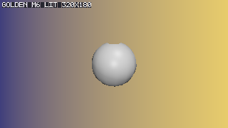

# M6 — 光照与休眠接口

里程碑产出：三种着色模式并存、`3` 键实时切换（unlit / Gouraud / 逐像素 Blinn-Phong，
默认 Phong）；光参数从命令行来、按键微调、当前值显示在 HUD 第三行；球体上看得见
**不饱和**的高光带，Gouraud 与逐像素的差别被三条量化断言钉住；一张 lit golden 进回归
（`m6_lit_sphere.bmp`）；分阶段计时与 `--bench` 从"声明了没人写"变成真的。467 个用例
三侧全绿（MSVC Debug / MSVC Release / g++，含 `pow` 的比对 MSVC-only，C1′；M6.8 收口时 461，
M6.9 补 P95/P96/P109/P110 六条到 467）。

（这张 PNG 是**文档插图**，由已提交的参考图 `assets/golden/m6_lit_sphere.bmp`（320×180）
无损转换而来，不是新渲染、不是回归资产；参考图的 provenance 与门禁见
`assets/golden/README.md`。球是 12 stacks / **15 slices（奇数）**——轮廓略多边形化，
那个密度是为断言量出来的，不是画质选择，见 ③。）

---

## ① 休眠接口：声明了没人读的字段不是中性的，是把 0 读成结论的陷阱

**主张：一个字段被声明、被注释"留给 Mx"、却从来没有人读，它不是"为未来预留"，
而是一个陷阱——读到 0 的人会得到"这个阶段很快/这个值没问题"的结论，
那比没有测量更糟。** M6 的第一件事（M6.0）不是写 shader，是把 M3 留下的休眠接口叫醒。

全表（M6 之前生产代码里的事实；行号是当时的，核过的位置见设计 §1/§1.1）：

| 东西 | 生产代码里的事实 | 核过的位置 |
|---|---|---|
| `Varyings::worldNormal` | **没有任何 shader 读它** | `builtin_shaders.cpp` 三个 FS 全文 |
| `Varyings::worldPos` | 没人读，而且**存的是物体空间位置**，字段名却叫 world | 旧 `builtin_shaders.cpp:13` `v.worldPos = in.position;` |
| `VertexUniforms::normalMatrix` | **生产侧四处全是 `identity`**，包括 model = rotX(0.43)·rotY(0.61) 的 golden | `main.cpp:150`、`golden_scene.cpp:83/111`、`obj_scene.cpp:24`（M6.0 前） |
| `Mat4::tryInvert / transposed / upper3x3AsMat4` | 存在、也被测过，但**生产侧没有任何调用点** | `test_mat.cpp:108-148` 只在测试里覆盖 |
| `FrameStats::msVertex / msClip / msSetup / msRaster` | 声明、`merge()` 里加总，**全仓库没有任何一处写它们**；后端只写 `msTotal` | 旧 `stats.h:31-34`、旧 `render_backend.cpp:138` |
| `--bench N` | 只设 `bench`/`offscreen`，**不设 `frames`** ⇒ `--bench 60` 实际跑 1 帧 | 旧 `cmdline.cpp:185-191` |
| `bench/timer.h` 的头注释 | "用于 FPS、`--bench` 与分阶段耗时（FrameStats 里的 ms* 字段）"——**注释承诺了一件从未发生的事** | `timer.h:8`，自 M0 的 `a672b65` 起一字未动，直到 M6.7 才成真 |
| 旧 `main.cpp:161` 的顶点色注释 | "M6 的光照 shader 还要它"——M6.3 之前没有任何 shader 消费顶点色 | D17 兑现（今 `main.cpp:167-168`，Gouraud 的 albedo 用顶点色，见 ③） |
| MTL 的 `Ka`/`Ks`/`Ns` | M5 解析并存进 Material，M5 不参与着色 | M5 设计 D5；M6.1/M6.2 起消费 |

第三行是**当前就存在的错**：纯旋转时 `transpose(inverse(R)) = R`，而 `transformVS` 做的是
`normalMatrix * normal`，所以 golden 场景的 `worldNormal` 一直是**未旋转的法线**。
它今天无害，因为没人读它——"无害"正是休眠接口最危险的状态：**错误已经发生，只是还没被观测**。

**更尖锐的说法（评审纠正了第一版的夸大，纠正之后故事更锋利）**：不是"没人算对过"——
`tests/unit/test_pipeline_integration.cpp:26-28` 一直在算
`tryInvert(model) ? inv.transposed().upper3x3AsMat4() : identity`。
**正确的配方活在测试夹具里，生产代码里一处都没有。** 一个已经写对、也已经测过的用法，
绕开了所有真实调用点。（第一版写"每个调用方都传 identity"是夸大；设计 §14.1 留档。）

第二批休眠字段还咬了本章自己一口：**M6 设计第一版的 D8 正打算在这四个 0 上做 A/B 测量**
（"FrameStats 已有分阶段计时，所以不需要新增"）。读到 0 会得到"这个阶段几乎不花时间"——
设计 §1.1 把它列为反目标 A6（"把 0 读成测量"），D21 因此把"叫醒四个字段 + 修 `--bench`"
纳入 M6，M6.7 落地。本章谴责的失效模式，第一版设计自己就踩了一次。

**它们真的睡着的证据（M6.0 实测）**：把 `worldPos`/`worldNormal` 的语义改掉
（物体空间 → 真世界空间、归一化移到变换之后），**两份既有 golden 逐字节不变**——
M4 md5 `1f767a114a49d38c454448eec4465d51` 与 BASE 相同，M3 与 BASE 渲染 `cmp` 零差异
（M6.0 报告 §4）。改了字段没改画面 = 没有任何 shader 读它们，论点成立。

**一般规则：a declared-but-unread field is not neutral, it is a trap that turns 0 into a conclusion.**
代价：叫醒它的成本不是那几行代码，而是**必须证明它醒着**。M6.0 之后"生产侧改回 identity"
在像素上仍然是惰性的（没有 FS 读这两个字段），所以接线的唯一硬证据是 M6.8 的破坏性验证 #13
（lit 场景的法线矩阵改回 identity ⇒ 比对红 **2985 像素**，第一个在 (149,60)，M6.8 报告 §5）。
那条地板的能力边界见 ⑤ 之后的补记——**它证明"法线被消费"，不证明 inverse-transpose 机器本身**，
别说过头。

## ② inverse-transpose 是几何必然，不是仪式

**主张：法线要用 (M⁻¹)ᵀ 变换，因为要保的是"与表面垂直"，不是"长度是 1"。**
推导一行：切向 `t` 满足 `n·t = 0`；变换后切向变成 `Mt`，要 `n'·(Mt) = 0` 对所有 `t` 成立
⇒ `n' = (M⁻¹)ᵀn`，因为 `((M⁻¹)ᵀn)ᵀ(Mt) = nᵀM⁻¹Mt = nᵀt = 0`。
均匀缩放下它退化成"归一化一下就行"，所以仪式看起来像多余的——**非均匀缩放才是判别器**。

**可执行的推导（`scale(2,1,1)`，每个数都在测试里，`test_transform.cpp:159-185`）**：

- 物体空间的面取 `p0=(0,0,0)、p1=(1,-1,0)、p2=(0,0,1)`，法线 `n = normalize(1,1,0)`。
  **测试先断言前提**：`dot(n, p1-p0) ≈ 0` 且 `dot(n, p2-p0) ≈ 0`（容差 1e-5）——
  n 真的垂直于所给表面，后面的推导才有意义。
- 缩放后切向 `t1' = (2,-1,0)`、`t2' = (0,0,1)`。
- **朴素变换**（直接拿 model 的 3x3 乘法线）：`model·n = (2,1,0)/√2`，
  `dot(·, t1') = (4-1)/√2 = 3/√2 ≈ 2.12`——垂直性丢了（测试断言 `> 0.1`）。
- **法线矩阵**：`makeNormalMatrix(scale(2,1,1)) = diag(0.5,1,1)`，
  `nOut = normalize(0.5,1,0) ≈ (0.4472, 0.8944, 0)`，与 `t1'`、`t2'` 的点积都 ≈ 0（1e-5）。

前提断言不是装饰：M6.0 的简报夹具曾自相矛盾——面给的是 xy 平面（法线应是 (0,0,1)），
却声称 `n=(1,1,0)/√2` 垂直于它；且 z 方向法线在 `scale(2,1,1)` 下方向不变，
"朴素变换失去垂直性"的现象在那个面上**不可能出现**。实现者按设计的 n 与 scale 反推出正确的面，
并把矛盾写进测试注释（M6.0 报告 §2，本项目文档第八次被下游抓错）。
**规格里出现"表面/法线"这类成对对象时，两个都必须写死；只写一个等于把矛盾留给下游发现。**

连带两条，各有自己的变异（M6.0 报告 §5）：

- **归一化必须在变换之后**（D4）：非均匀缩放改变长度，变换前归一化等于没归一化。
  输入 `n=(1,1,0)`（长 √2）经 `diag(0.5,1,1)` 后长 √1.25 ≈ 1.118；若只在乘法前归一化，
  输出长 √0.625 ≈ 0.7906 而不是 1（变异②的实测红值）。
- **奇异兜底用相对阈值，且先取 3x3 再求逆**：`scale(1e-5,1e-5,1)` 的 det = 1e-10 ≠ 0，
  数学上可逆、数值上不该求逆（条件数 1e5 会把法线放大五个数量级）——固定阈值 `det != 0`
  的变异在这里红（变异④）。先取 3x3 是因为 `tryInvert` 的相对阈值按整个 4x4 的量级算，
  大平移列会污染 maxAbs（`transform.h:65` 的注释有算例）。

**#13 的能力边界（与补记互引）**：lit golden 的姿态是**纯旋转**，纯旋转的逆转置等于自身
⇒ 把 `makeNormalMatrix` 换成"直接取 mat3(model)"，那张 golden **不会红**。
区分两者只能靠上面的非均匀缩放单元测试。golden 证"消费"，单测证"数学"，两层缺一不可
（Ruling 85/89 的分层）。

## ③ 为什么 Gouraud 够不到紧的高光——以及第一版那条断言为什么是假的

**主张：Gouraud 的高光是顶点值的凸组合，三角形内部够不到 `N·H → 1` 的峰；
逐像素在每个像素重算半向量，所以峰能落在顶点之间。** 这是"求值点"的差别，
不是"有没有高光"的差别——教科书 Gouraud 本来就在顶点算**完整**光照（含高光）再插值结果
（Ruling 91/D25：第一版让 Gouraud 只算漫反射，那样 §8.2 #7b 会退化成"没有 vs 有"的空转对照）。

**但第一版写下的断言是"逐像素的最大亮度严格大于 Gouraud 的最大亮度"——那条在真实夹具上是假的**，
两个独立的原因（设计 §14.5，评审在真实夹具上算了一遍抓出来的）：

1. **饱和 clamp**：`encodeSRGB`/`linearToSrgb8` 把输入 clamp 到 [0,1]（`color.cpp:21-27,64-69`）。
   默认光强一旦让线性值超过 1，**两张图在峰值处都变成 255**——"严格大于"在像素层面消失，
   比较的是两块白饼。
2. **头灯几何下峰恰好落在顶点上**：点光默认跟随相机（产品方选的形态 C），
   正对相机的那个球面点 `N = V = L` ⇒ `N·H = 1` 是全局峰；`slices` 取偶数时
   **那个点恰好是一个网格顶点** ⇒ Gouraud 在顶点处直接采到峰，凸组合的上界就是峰本身。
   "峰值必然落在顶点之间"不成立。

**换成什么**：不比最大值，比**峰的宽度**与**峰的位置**——凸组合论证真正预言的是
"能量被摊开"，不是"最大值更小"。落地为三条量化断言（M6.8，夹具就是生产 golden 本身：
无贴图球 12/15、`goldenLitRig()` 单例、同一姿态）：

- **#7b 半高宽/面积**（`gouraud_smears_the_specular_peak_that_per_pixel_localizes`）：
  高光隔离 = linear(full) − linear(Ks=0 对照)。点瓣局部半高宽 **P=10 / G=13**，
  全局半高面积 **P=121 / G=181**；阈值宽比 ≥1.25（实测 1.30）、面积比 ≥1.3（实测 1.496）、
  wG ≥ wP+2、aG ≥ aP+4。半高宽在**线性**域量（sRGB 半高 ≠ 线性半高）。
- **#7c 峰位随眼动**（`the_per_pixel_highlight_center_moves_with_the_eye`）：
  全局峰钉在 `pixelOf(normalize(eyeWorld))`（手写 NDC→像素，不让被测视口给自己打分），
  容差 2.5px。眼转 0.35 rad ⇒ 峰位移 **13px**、重心位移 **10.18px**；
  只改 `keyDir` ⇒ 高光重心移 **8.35px**、漫反射重心移 **4.41px**（Ruling 67 的第二个合法值）。
  漫反射不随眼：点光固定、只动 eye ⇒ Ks=0 对照帧**逐字节相同**。
- **#8 边界 kink**（`interpolation_kink_at_triangle_edges_is_stronger_under_gouraud`）：
  指定扫描线（全帧最亮行 y=75）的二阶差分，边/内比 **P=2.034 / G=3.022**、
  内部 |D2| 均值 P=0.00452 / G=0.00254（Gouraud 内部仿射 ⇒ 只剩量化噪声）、
  斜率归一化 kink P=0.430 / G=0.555。**不叫 Mach band**：那是感知的过冲（侧抑制），
  不是像素性质；二阶差分能测的是一阶导的不连续，且逐像素的法线在球面网格上也只是 C0，
  边界 kink 两张图都有（设计 §14.6 的范畴错误纠正）。Mach band 用图说明，断言只测可测的东西。

**两个实测纠偏，都写进了注释（M6.8 报告 §4/§9）**：

- **夹具密度是量出来的**：24/31 的细网格上三角形（7.5°×11.6°）比 Ns=64 的高光带（±8.4°）还小，
  Gouraud 摊开与逐像素带同宽（半高宽 10 vs 10），#7b 空转；10/13 更粗时 Gouraud 自身半高宽
  反而缩到 9（顶点采样丢峰太多，半高阈值跟着降）。**12/15 是分离度成立的区间**——
  后人"优化"网格密度会静默废掉断言，所以密度成了断言的前提，写在常量注释里。
- **默认 rig 的高光是双瓣的**：点瓣峰 Ks·pointInt = **0.14** 在正对眼的球面点，
  key 瓣峰 Ks·keyInt = **0.1225** 在 N≈H_key 处（投影 ≈(171,74)，距点瓣中心 19.4px）。
  第一版注释声称"key 高光可忽略"——只在**点瓣位置**求值时成立（那里 N·H_key ≈ 0.89 ⇒ 7e-5），
  全局上两瓣同量级。#7c 的裸重心因此被 key 瓣拉偏 6.7px，纠偏后才是"峰位钉 + 重心位移"双断言。
  **一个看起来像数学常识的断言，被一个具体夹具推翻**——这是本章最有教学价值的一段。

**前提的前提：不饱和（D19）**。默认参数必须让峰值留在线性 1.0 以下，否则 ③ 的全部比较失效。
app 实测：phong 帧 max-channel **193**、gouraud **185**，零个 255 字节（M6.6 报告 §6）；
lit golden 有专门断言 `lit_golden_has_a_highlight_that_does_not_saturate`（高光像素 >0 且峰值 <255）。
这不是"更好看"，是让比较有意义的前提。一旦故意把强度调到饱和，两张图都变成白饼——
**这就是为什么很多渲染器需要色调映射**；本项目不做（N2/§3），但要知道它为什么存在。

## ④ 线性空间与 sRGB：谁解码、在哪解码、为什么必须恰好一次

**主张：所有光照运算在线性空间，只在写颜色目标那一刻编码 sRGB（spec §7.1）；
每一种输入颜色在它进入管线的那一站解码一次，且只解码一次。** 解码时机表：

| 输入 | 存储域 | 解码发生在 | 位置 |
|---|---|---|---|
| 光色（`--key-color` 等 CLI） | AppOptions 存**原始 sRGB 浮点** | `buildLightRig` 组装 rig 时，经 `decodeLightColor` → `srgbToLinear(float)` | `scene.cpp:112 起`、`lights.h:58` |
| 材质色（MTL 的 `Kd`/`Ka`/`Ks`） | 文件里的 sRGB 浮点 | **解析时**（`srgbToLinear(LinearColor)`） | `mtl.cpp:118` |
| 顶点色 | 程序生成几何**直接在线性域创作**（面色常量 / `applyPositionColors` 的 0.5+0.5·d），不经解码；OBJ 几何无顶点色，后端兜底白 | 无（不是 sRGB 数据） | `mesh.cpp:193-199`、`obj.cpp:300`、`render_backend.cpp:136` |
| 纹素（贴图） | **8bit sRGB 原样**存，`Texture::srgb` 标志 | **采样时**逐像素（`toTexelF`，由标志门控） | `sampler.cpp:50-66` |
| 输出 | 线性 `FragmentOutput` | 写颜色目标那一刻 `encodeSRGB`，**单一编码点** | `render_backend.cpp:117` |

**`Kd` 解析时 vs 纹素采样时的不对称（M5 D5，M6 审视后维持）**：`Kd` 是文件里的一个浮点数，
没有"采样时"可用，只能在解析时定身；若先量化成 uint8 再解码会白白引入一档误差。
贴图则不在加载时解码，三个理由各有代价对照（M4 notes §3）：加载时解码要 ×4 内存、
mip 平均会在编码空间里做（那是错的平均）、数据纹理（法线/查找表）不该被解码。
**M6 的审视结论**：这条不对称是对的，维持；新增的约束是 D26（见下）与 D19（解码一次 +
不饱和默认）。回写已加进 M5 设计 D5，读 M5 的人不会以为 TODO 还开着（见本章末尾）。

**D26 契约：`albedo` 形参是未乘材质系数的基础色，被调方乘 `Kd`。**
`shadeDiffuseOnly`/`shadeBlinnPhong` 内部就做 `kd = cmul(albedo, mat.diffuse)`（`shading.h:86`）。
D17 第一版把 albedo 写成顶点色与 diffuse 的乘积（调用方乘 `Kd`；错式字面按终审修复波
全文清扫移除，M6.9 移除错值同政策），字面照做会把 `Kd` **乘两次**：
`Kd 0.5` 的模型暗一档（0.5² = 0.25）。M6.3 的 TDD 正是抓到 **`0.125 ≠ 0.25`** 才发现规格歧义
（简报夹具第二组期望 0.25，实得 0.125，第一次 GREEN 尝试当场红，M6.3 报告 §1/§3）。
M6.4 的 `texel × diffuse` 是同一陷阱的第二次落点，派发词预先写明。
**一般化（本项目第十一次文档错误）：一个形参叫 `albedo`、另一个字段叫 `diffuse`，
两者相乘的关系必须在签名处写死由谁乘——"看起来是同义词"的参数名是双重乘算的温床。**

**解码一次的数值锚**：`--key-color 0.5 0.5 0.5` ⇒ rig 里 ≈ **0.2140**
（`((0.5+0.055)/1.055)^2.4 ≈ 0.2140`），不是 0.5（没解码）、也不是 0.25（解码两次）。
测试 `buildLightRig_decodes_colors_and_defaults_radius_to_three_times_the_scene` 钉住。

**法线视图的 wart：线性 0.5 编码成 188，不是 128。**
`debugNormalFS` 输出 `(N+1)/2`（线性域），出口恒定 `encodeSRGB` ⇒ N=(0,0,1) 的像素是
(188,188,255)。188 来自 **IEC 61966-2-1 分段曲线**（`color.cpp:11-14`，接缝 0.0031308）：
0.5 > 接缝 ⇒ 幂段 `1.055·0.5^(1/2.4) − 0.055 = 0.735357`，×255 = 187.516 ⇒ lround = **188**。
不是 128（那是没编码）、不是 186（gamma-2.2 纯幂）、**也不是计划第一版把解码方向当成
编码方向算出的那个错值**（M6.5 报告 §3 实测纠正；错值字面按 M6.9 评审轮移除，正确值 188）。这是输出侧单一编码点的**正确后果**，不是 bug；
`Texture::srgb=false` 管的是**输入侧**（采样时纹素解不解码），两件事别混。
法线视图因此是粉彩的（0 分量编码成 188），肉眼门判据 accordingly 是"颜色钉在世界轴上"
（M6.5 报告 §10）。推导与测量记录在 `test_view_mode.cpp` 文件头。

## ⑤ A/B 帧时间实测（M6.7，D21/D8）

**这批数字是 M9 结论的前置**（M8 的 15 fps 预算要对着它们谈）。

**区间声明（P108，读表前必看）**：本表的场景是 **12–24 三角形/帧**，raster 段占 draw 时间
约 **99%**（6.09/6.10、3.19/3.20、10.64/10.65、9.70/9.71）——这是**着色主导**（shading-dominated）
区间，正是上游 spec §7.3 把 SIMD 排除在 shading 之外所针对的情形：几何阶段几乎不花时间，
逐像素着色才是瓶颈，所以 M9 的 SIMD 只覆盖覆盖判定/插值/深度掩码，不覆盖 shading。
**因此这些模式比值不许外推到几何密集的场景**——三角形数上去之后 VS/clip/setup 的份额会涨，
"gouraud 比 unlit 快"这类结论的成立条件（光在顶点算、FS 不采样）虽然仍在，但各段的权重会变，
M8 的高密度场景必须重测，不能沿用本表。

### 测量条件（性能数字必须能归因到具体构建）

- 构建标识（`buildInfoString()` 原文）：`soft-raster 0.0.1 Release MSVC`
- 工具链：MSVC 19.40.33812（Visual Studio 17 2022），`/W4 /utf-8`，Release `/O2`；
  构建经 `cmake --build build --config Release --clean-first`，零警告。
- 机器：Intel Core Ultra 9 275HX（Windows 11）。**不是 Debug**：MSVC Debug 关内联、
  开迭代器调试，着色模式之间的比值会被调用开销主导而不是数学本身。
- 分辨率 1280×720；每行 60 帧（`--bench 60`，D21 修复后真的跑 60 帧）。
- 场景 A（默认场景）：程序生成兜底立方体，**12 三角形**，程序棋盘贴图，
  三线性采样 + mip（默认旋钮），默认 rig（D19 不饱和参数）。
- 场景 B：`assets/obj/twomats.obj`，**24 三角形 / 3 组**（DC/帧 = 3），默认 phong。
- 每行取 2 次运行的平均（phong 行 4 次）；单次运行间的整机抖动约 ±3%。

### 表 1：三种着色模式（场景 A，同一几何与覆盖）

| 模式 | msTotal/帧 | VS | clip | setup | raster | 整帧 ms/帧 | 着色片元/帧 |
|---|---|---|---|---|---|---|---|
| unlit（texturedFS） | 6.10 | 0.002 | 0.004 | 0.003 | 6.09 | 6.62 | 60024 |
| gouraud（lambertPerVertexFS） | 3.20 | 0.006 | 0.003 | 0.003 | 3.19 | 3.58 | 60024 |
| phong（blinnPhongPerPixelFS） | 10.65 | 0.002 | 0.004 | 0.004 | 10.64 | 11.26 | 60024 |

（单位 ms；四舍五入到 0.01/0.001。命令：`soft-raster --bench 60 --shade <mode>`。）

**为什么 gouraud 比 unlit 还快**——这不是测量错误：本项目的 unlit 是
`texturedFS`（逐像素三线性采样，不算光），gouraud 是 `lambertPerVertexFS`
（光在顶点算，FS 只输出插值色，**不采样贴图**）。三个模式的差异不只是"光在哪算"，
还有"采不采样贴图"。逐像素三线性采样（8 纹素 + 两级插值）比逐顶点 Lambert 贵得多。
phong = 贴图 albedo × 逐像素 Blinn-Phong，是三者里最贵的，约为 gouraud 的 3.3 倍。
**VS 列佐证机制**：gouraud 的 VS 时间（0.006）是另两个模式（0.002）的 3 倍——
`lambertVS` 在每个顶点跑完整 Blinn-Phong（Ruling 91），而另两个模式的 VS 只做变换。
光被挪到了顶点，VS 变贵、FS 变便宜，净效果是更快（因为本场景 FS 的工作量远大于 VS）。

### 表 2：导入模型（场景 B，phong）

| 场景 | msTotal/帧 | VS | clip | setup | raster | 整帧 ms/帧 | 着色片元/帧 | DC/帧 |
|---|---|---|---|---|---|---|---|---|
| twomats.obj（24 三角形） | 9.71 | 0.004 | 0.006 | 0.006 | 9.70 | 10.29 | 95126 | 3 |

### 口径与计时本身的开销（观察者效应）

- **口径**：`msTotal` 与四个阶段只覆盖 `drawRange`（提交到像素写完）；"整帧"另含
  clear/HUD/sink/写回，由 app 层的帧秒表测。两者之差（约 0.5–0.6 ms）就是帧内
  非 draw 工作。四段**划分** msTotal：`stage_timers_partition_the_total` 钉住
  sum(ms*) ∈ [0.5, 1.05]×msTotal，实测比值 0.9994–0.9997（三种构建各 3 次）。
- **观察者效应（实测）**：同一场景 A / phong / 60 帧，把四个阶段计时编译出去
  （临时用 BASE `c6697d9` 的 render_backend.cpp 做 Release 构建，未提交开关）：
  - 计时在：msTotal/帧 = 10.655 / 10.652 / 10.581 / 10.706，平均 **10.649 ms**
  - 计时不在：msTotal/帧 = 10.866 / 10.696 / 10.563 / 10.509，平均 **10.659 ms**
  - 差 ≈ **−0.01 ms（−0.1%）**，方向还是"在比不在快"——完全淹没在运行间抖动
    （两组各自的极差约 0.13 / 0.36 ms，≈1–3%）里。**在本表使用的三角形数
    （12–24/帧，均未裁剪）下，计时开销可忽略**：每个未裁剪三角形 4 次 QPC 读 ≈ 48–96 次/帧 ≈ 1–2 µs，
    （P107 修正：裁剪成 n 顶点的多边形至多 16 次读，见 render_backend.cpp 注释）
    占帧时间 ~0.01%，测不出来是应该的。
  - 但这条结论**随三角形数线性失效**：10 万三角形/帧 ⇒ 40 万次读时钟 ≈ 10 ms 量级。
    M8 若上高密度场景，必须重测观察者效应，不能沿用本表的"可忽略"。
- 计时不改像素：M4 golden md5 与 BASE 逐字节相同（`1f767a114a49d38c454448eec4465d51`），
  M3 过 ctest ±1 门（Ruling 50，不重生成）。

### 与 brief 的一处偏离（记录在案）

brief Step 5 写"lit 球 + 默认 rig + 三线性贴图另测一组"，但 `assets/obj/` 只有
cube.obj 与 twomats.obj，**没有球模型**（lit 球是 M6.8 的程序生成 golden，不是 OBJ 资产）。
按派发词的命令实测：默认立方体场景 × 三模式 + twomats.obj 一组。

## 补记（M6.8 评审）：#13 地板的能力边界 —— 不要写成"证明了法线矩阵正确"

lit golden 的破坏性验证 #13（`renderGoldenSceneLit` 的法线矩阵改回 identity ⇒
比对红 2985 像素，首 (149,60)）证明的是：**worldNormal 真的被光照消费，且姿态旋转
有意义**（单位阵会让法线停在物体空间，高光/漫反射整片错位）。

它**不证明 inverse-transpose 这套机器本身**：golden 姿态是**纯旋转**
（`goldenModel()` = rotX·rotY），纯旋转的逆转置等于自身 ⇒ `normalMatrix == mat3(model)`
数值上相等。把 `makeNormalMatrix` 的实现换成"直接取 mat3(model)"，这张 golden
**不会红**。区分两者需要**非均匀缩放**（scale(2,1,1) 下逆转置 ≠ mat3），那归
`makeNormalMatrix`/`setNormalMatrix` 自己的单元测试（M6.0 已钉：
`normal_is_normalized_after_the_transform_not_before`、奇异 model 拒绝等）。
②（inverse-transpose）节已引用本条，别把 #13 的能力说过头。

## M5 D5 的审视结论（回写已完成）

M5 设计 D5 明写"M6 换 shader 时要重新审视 `Kd` 在解析时解码这件事"。M6 做了那次审视，
结论是**维持不对称、补两条约束**：`Kd`/`Ka`/`Ks` 仍在解析时解码（M5 D5 的理由成立），
经 `MaterialShade` 以指针送进 VS/FS 两个阶段（D15，单一真源）；解码一次且只一次
（D19，光色同走 `srgbToLinear(float)`）；`albedo` 形参未乘 `Kd`、被调方乘（D26，
TDD 抓到 `0.125 ≠ 0.25` 后定死）。这三条已实施并有测试。回写一句已加进
[`M5 设计 D5`](../superpowers/specs/2026-11-22-soft-raster-m5-obj-design.md)，
读 M5 的人不会以为那个 TODO 还开着。

## 交叉链接：笔记与"从零实现"系列（尚未存在）

产品方已委托一套独立的教学系列 `docs/guide/00..11`（"从零实现"章节，每章配一个
最小可编译片段 + `file:line` 交叉引用）。**它还不存在**——本节先占位说明分工，
不链接到空目录：

- **本笔记（`docs/notes/`）是"推导与坑"的记录**：每个主张后面跟着推导或实测，
  以及代价；它回答"为什么是这样、哪里会错"。
- **guide 系列将是"自己动手建"的路径**：按依赖顺序重走一遍管线，每章一个能跑的最小片段，
  用 `file:line` 指回本仓库的真实实现。

两者互引：guide 的"为什么"指向 notes，notes 的"怎么建"指向 guide。
